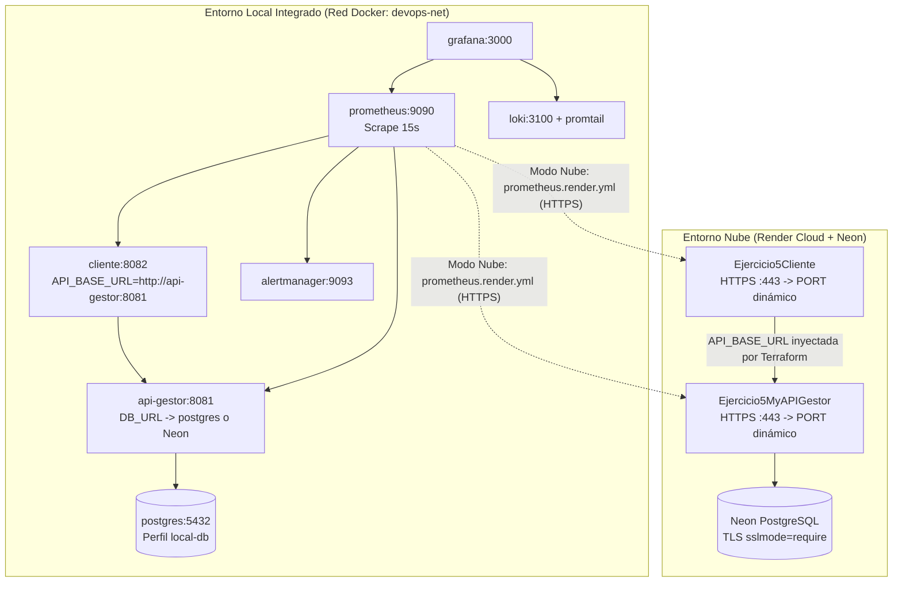

# Informe Técnico · Evaluación Final: Circuito DevOps con Infraestructura como Código (IaC)

## Liberación Continua, Aprovisionamiento Declarativo en la Nube, Observabilidad y Evaluación de Rendimiento del Sistema `admin-proyectos`

---

| Campo | Detalle |
| :--- | :--- |
| **Institución:** | Universidad Tecnológica del Norte de Guanajuato (UTNG) |
| **Materia:** | Gestión del Proceso de Desarrollo de Software \| Unidad III: Proceso de liberación y monitoreo |
| **Evaluación:** | Evaluación final · Circuito DevOps con IaC (Unidad III) |
| **Alumno:** | César Enrique Garay García |
| **Grupo:** | `[Editable: especificar grupo, p. ej. IDGS-XX]` |
| **Periodo:** | `[Editable: especificar periodo cuatrimestral, p. ej. Septiembre – Diciembre 2026]` |
| **Fecha:** | Diciembre 2026 *(Defensa presencial: viernes 4 de diciembre de 2026)* |
| **Repositorio GitHub:** | `https://github.com/cesargaray-dev/admin-proyectos` |
| **Ecosistema Tecnológico:** | Java 21 LTS · Spring Boot 3.3.5 · Jenkins LTS · Maven/Surefire/JaCoCo · SonarQube · Semgrep · Docker · Terraform (`render-oss/render`) · Render Cloud · Neon PostgreSQL · Prometheus · Alertmanager · Grafana · Loki/Promtail · OpenTelemetry · Grafana k6 |

---

## Tabla de Contenidos

1. [Objetivo y Alcance](#1-objetivo-y-alcance)
2. [Arquitectura DevOps y Decisiones Tecnológicas (6%)](#2-arquitectura-devops-y-decisiones-tecnológicas-6)
3. [Infraestructura como Código (IaC) y Despliegue Cloud (12% + 8%)](#3-infraestructura-como-código-iac-y-despliegue-cloud-12--8)
4. [Circuito CI/CD, Calidad y Seguridad (10%)](#4-circuito-cicd-calidad-y-seguridad-10)
5. [Monitoreo, Observabilidad y Alertas (7%)](#5-monitoreo-observabilidad-y-alertas-7)
6. [Evaluación del Rendimiento (7%)](#6-evaluación-del-rendimiento-7)
7. [Bitácora de Incidencias](#7-bitácora-de-incidencias)
8. [Conclusiones Técnicas, Limitaciones y Referencias](#8-conclusiones-técnicas-limitaciones-y-referencias)
9. [Checklist de Verificación y Anexo de Evidencias](#9-checklist-de-verificación-y-anexo-de-evidencias)

---

## 1. Objetivo y Alcance

### 1.1. Objetivo General

Diseñar, implementar, validar y documentar un **circuito DevOps completo de extremo a extremo con Infraestructura como Código (IaC)** para el sistema distribuido de administración de proyectos (`admin-proyectos`), integrando integración continua con aseguramiento de calidad y seguridad (CI/DevSecOps), aprovisionamiento declarativo y reproducible en la nube mediante Terraform hacia Render Cloud y Neon PostgreSQL, observabilidad integral (métricas, logs, trazas y alertas) y evaluación controlada del rendimiento mediante Grafana k6.

### 1.2. Objetivos Específicos

1. **Consolidar y endurecer los microservicios Java 21 / Spring Boot 3.3.5** (`Ejercicio5Cliente` y `Ejercicio5MyAPIGestor`) eliminando credenciales embebidas, desacoplando rutas y puertos mediante variables de entorno, incorporando telemetría nativa y empaquetándolos en contenedores Docker multi-etapa con ejecución no privilegiada (`non-root`).
2. **Aprovisionar la infraestructura cloud de forma declarativa y reproducible** mediante Terraform y el proveedor oficial `render-oss/render`, conectando automáticamente el microservicio frontend con la URL del backend y la base de datos gestionada Neon PostgreSQL bajo cifrado TLS.
3. **Evolucionar el circuito CI/CD en Jenkins local** para integrar compilación Java 21, pruebas unitarias (Surefire), compuerta de cobertura JaCoCo ($\ge 80\%$), análisis estático (SonarQube y Semgrep SAST), verificación de imágenes Docker, validación de IaC (`terraform fmt`/`validate`) y etapa parametrizada de despliegue continuo (CD) hacia Render con verificación post-despliegue.
4. **Implementar monitoreo, observabilidad y alertamiento como código** (*Observability-as-Code*) sobre Prometheus, Alertmanager, Grafana, Loki/Promtail y trazabilidad distribuida OpenTelemetry (`traceId`/`spanId`), soportando tanto el entorno contenerizado local como la inspección de servicios desplegados en Render.
5. **Evaluar objetivamente el rendimiento del sistema** mediante pruebas controladas y éticas de humo (*smoke*) y carga (*load*) en Grafana k6, midiendo latencia (media, p90, p95, p99), tasa de rendimiento (*throughput* en RPS) y tasa de error HTTP, y retroalimentando los hallazgos al ciclo de mejora continua.
6. **Mantener trazabilidad documental rigurosa** mediante una bitácora estructurada de incidencias reales encontradas y resueltas durante el proyecto, garantizando coherencia técnica verificable en código y ejecución.

### 1.3. Continuidad Técnica desde la Unidad II

El presente proyecto no parte desde cero, sino que da continuidad evolutiva a la modernización ejecutada durante la **Unidad II** (documentada en `evidencia_entrega/Documento_Explicacion_Upgrade_Java21.md`):

- **Base heredada de la Unidad II:**
  - Actualización de `Ejercicio5Cliente` desde Java 17 / Spring Boot 3.2.5 hacia **Java 21 LTS / Spring Boot 3.3.5** (Thymeleaf + Bootstrap 5.3.3).
  - Actualización de `Ejercicio5MyAPIGestor` desde Java 11 / Spring Boot 2.7.17 + `mariadb-java-client` hacia **Java 21 LTS / Spring Boot 3.3.5 (Jakarta EE)** + controlador JDBC **PostgreSQL**.
  - Incorporación en ambos `pom.xml` de `maven-surefire-plugin:3.3.1`, `jacoco-maven-plugin:0.8.12` (umbral mínimo de cobertura de instrucciones del 80%) y `sonar-maven-plugin:5.5.0.6356`.
  - Construcción del entorno CI local en Docker Compose con **Jenkins LTS (JDK 21)** y **SonarQube Community LTS**, logrando en la Unidad II **53 pruebas unitarias (95.2% de cobertura en SonarQube)** para `Ejercicio5Cliente` y **43 pruebas unitarias (99.4% de cobertura en SonarQube)** para `Ejercicio5MyAPIGestor`, además de la remediación posterior de hallazgos de calidad (`java:S106`, `java:S1854`) y seguridad SAST con Semgrep (integridad SRI en CDN de `home.html` y `proyecto.html`, cerrando en 0 hallazgos en la revisión final de Unidad II).
- **Salto arquitectónico de la Unidad III:**
  - Unificación operativa en el repositorio `https://github.com/cesargaray-dev/admin-proyectos` con empaquetado Docker productivo para ambos microservicios.
  - Migración de configuración estática a configuración 12-Factor orientada a nube (`PORT`, `API_BASE_URL`, `DB_URL`, `DB_USERNAME`, `DB_PASSWORD`), eliminando secretos del repositorio.
  - Incorporación formal de IaC con Terraform (`infra/terraform/`), despliegue en Render Cloud + Neon PostgreSQL, stack completo de observabilidad (`monitoring/`) y evaluación de rendimiento con k6 (`performance/`).

### 1.4. Alcance Funcional y Restricciones Operativas

| Dimensión | Alcance Cubierto | Restricciones y Consideraciones |
| :--- | :--- | :--- |
| **Capa de Aplicación** | Frontend web MVC (`Ejercicio5Cliente`) y API REST JPA (`Ejercicio5MyAPIGestor`) en Java 21 / Spring Boot 3.3.5. | Conservación del contrato funcional CRUD existente de usuarios, proyectos, tareas, comentarios y asignaciones. |
| **Persistencia** | Base de datos gestionada **Neon PostgreSQL** (producción cloud) y contenedor PostgreSQL opcional mediante perfil `local-db` (pruebas locales reproducibles). | Conexión cifrada obligatoria (`sslmode=require`) en Neon; pool HikariCP acotado (`DB_POOL_MAX=5`) para evitar agotamiento de conexiones en plan gratuito. |
| **Infraestructura y Nube** | Aprovisionamiento declarativo con Terraform (`render-oss/render`) sobre **Render Cloud** (2 Web Services Docker). | Plan `free` de Render (512 MB RAM, *spin-down* tras inactividad): requiere afinación explícita de memoria JVM y pruebas de carga éticas y acotadas. |
| **CI/CD y Seguridad** | Jenkins local (`docker-compose.yml`), `Jenkinsfile` unificado, SonarQube, Semgrep SAST, validación Docker/Terraform y CD opcional. | Cero credenciales, contraseñas, tokens o claves privadas versionadas en Git; archivos `*.tfvars`, `.env` y `*.tfstate*` excluidos vía `.gitignore`. |
| **Observabilidad y Rendimiento** | Actuator + Micrometer + OTel + Prometheus + Alertmanager + Grafana + Loki/Promtail + k6 (`smoke` y `load`). | Ejecución verificada localmente sobre red compartida `devops-net` y plantillas listas para monitoreo/pruebas contra HTTPS en Render. |

> [!NOTE]
> Este documento constituye el **Informe Técnico Oficial de la Evaluación Final (Sección 6 de la rúbrica)** acompañado de la guía operativa y de defensa en `docs/Guia_Despliegue_Render_y_Defensa.md`. Por alcance establecido, no se genera un Portafolio de Evidencias independiente; en la Sección 9 se incluye el anexo técnico de verificación para trazabilidad en defensa presencial.

---

## 2. Arquitectura DevOps y Decisiones Tecnológicas (6%)

### 2.1. Diagrama de Arquitectura del Circuito DevOps End-to-End

El siguiente diagrama representa el circuito DevOps completo implementado para `admin-proyectos`, desde el control de versiones hasta el despliegue en la nube, la observabilidad continua y el bucle de retroalimentación basado en métricas y rendimiento:

```mermaid
flowchart LR
    subgraph DEV["1. Desarrollo y Control de Versiones"]
        A["Desarrollador<br/>(Java 21 + Git)"] --> B["GitHub Monorepo<br/>cesargaray-dev/admin-proyectos"]
    end

    subgraph CI["2. Integración Continua y DevSecOps (Jenkins Local)"]
        C["Jenkins LTS (JDK 21)<br/>Jenkinsfile Unificado"]
        D["Maven 3.9.9<br/>Surefire + JaCoCo >= 80%"]
        E["SonarQube LTS<br/>Calidad y Cobertura"]
        F["Semgrep SAST<br/>Seguridad de Código"]
        G["Docker Build Check<br/>Multi-Stage Non-Root"]
        H["Terraform Validate<br/>fmt + init + validate"]
        C --> D --> E --> F --> G --> H
    end

    subgraph IAC["3. Infraestructura como Código (IaC)"]
        I["Terraform CLI / Container<br/>Provider render-oss/render"]
        J["Variables Sensibles<br/>terraform.tfvars (fuera de Git)"]
        K["Estado Declarativo<br/>terraform.tfstate (local/ignorado)"]
        J --> I
        I <--> K
    end

    subgraph CLOUD["4. Entorno Productivo Cloud (Render + Neon)"]
        L["Render Web Service<br/>Ejercicio5Cliente (Frontend)<br/>HTTPS + /actuator/health"]
        M["Render Web Service<br/>Ejercicio5MyAPIGestor (Backend)<br/>HTTPS + /actuator/health"]
        N[("Neon PostgreSQL<br/>Serverless Managed DB<br/>TLS sslmode=require")]
        L -- "HTTP/HTTPS via API_BASE_URL" --> M
        M -- "JDBC + HikariCP (max 5)" --> N
    end

    subgraph OBS["5. Monitoreo, Observabilidad y Alertas"]
        O["Actuator + Micrometer<br/>+ OTel (traceId / spanId)"]
        P["Prometheus<br/>Scraping 15s + Reglas PromQL"]
        Q["Alertmanager<br/>Agrupación y Enrutamiento"]
        R["Grafana<br/>Dashboard como Código"]
        S["Promtail + Loki<br/>Logs Centralizados"]
        O --> P
        P --> Q
        P --> R
        O --> S --> R
    end

    subgraph PERF["6. Rendimiento y Retroalimentación"]
        T["Grafana k6<br/>Smoke & Load Controlado"]
        U["Reportes JSON / Markdown<br/>p95, RPS, Error Rate"]
        T --> U
    end

    B --> C
    H -- "Deploy Hooks / IaC Plan-Apply" --> I
    I -- "Aprovisiona y Enlaza API_BASE_URL" --> CLOUD
    CLOUD --> O
    T -- "Tráfico Controlado" --> CLOUD
    Q -. "Alertas Operativas" .-> A
    U -. "Retroalimentación de Rendimiento" .-> A
```



### 2.2. Topología de Red: Entorno Contenerizado Local vs. Nube Render

Para garantizar paridad entre validación local y operación en nube (*Dev/Prod Parity*), los contenedores de aplicación y observabilidad operan bajo los mismos contratos de variables de entorno y endpoints de telemetría:



### 2.3. Explicación Detallada del Flujo Completo

1. **Confirmación de cambios en Git/GitHub:** Cada cambio de código, configuración de contenedor, módulo Terraform o regla de observabilidad queda versionado en `cesargaray-dev/admin-proyectos`. Las credenciales y el estado de Terraform quedan bloqueados por `.gitignore`.
2. **Integración Continua y Validación DevSecOps (Jenkins Local):** Al ejecutarse el `Jenkinsfile`, Jenkins compila ambos microservicios con **JDK 21** y **Maven 3.9.9**, ejecuta las pruebas unitarias con **Maven Surefire**, exige una cobertura de instrucciones **JaCoCo $\ge 80\%$**, envía el análisis de calidad a **SonarQube**, ejecuta el escaneo SAST con **Semgrep**, verifica que ambos `Dockerfile` construyan imágenes válidas y valida sintaxis/formato del código Terraform (`terraform fmt -check` y `terraform validate`).
3. **Aprovisionamiento Declarativo con IaC (Terraform):** Terraform utiliza el proveedor oficial `render-oss/render` para declarar ambos servicios web Docker en Render, inyectar de forma segura las variables de base de datos (`DB_URL`, `DB_USERNAME`, `DB_PASSWORD`) y resolver automáticamente la dependencia entre frontend y backend inyectando la URL pública del API en `API_BASE_URL` del cliente.
4. **Despliegue Continuo y Ejecución en la Nube (Render + Neon):** Render construye cada contenedor desde el `Dockerfile` correspondiente, inyecta la variable dinámica `PORT`, valida disponibilidad mediante `/actuator/health` y expone ambos servicios detrás de HTTPS gestionado, mientras el backend persiste datos en **Neon PostgreSQL** mediante TLS. Desde Jenkins, la etapa CD opcional puede disparar *Deploy Hooks* de Render y verificar salud + prueba *smoke* automáticamente.
5. **Observabilidad Continua:** Ambos microservicios exponen métricas JVM/HTTP en `/actuator/prometheus`, sondas de salud en `/actuator/health` y trazas correlacionadas (`traceId`/`spanId` mediante puente OpenTelemetry) en sus logs. **Prometheus** recolecta métricas cada 15 segundos y evalúa reglas PromQL; si un umbral se viola, **Alertmanager** agrupa y enruta la alerta; **Promtail + Loki** centralizan los logs y **Grafana** consolida métricas, alertas y logs en un tablero aprovisionado como código.
6. **Evaluación de Rendimiento y Retroalimentación:** **Grafana k6** ejecuta escenarios *smoke* y *load* controlados sobre endpoints reales de lectura, produciendo reportes estructurados (JSON y Markdown) con latencias p90/p95/p99, RPS y tasa de error. Las alertas de Alertmanager y los hallazgos de k6 alimentan directamente nuevas optimizaciones de código, pool de conexiones y parámetros JVM.

### 2.4. Matriz de Justificación Técnica Coherente

Cada componente tecnológico del circuito fue seleccionado por criterios de **coherencia arquitectónica, reproducibilidad, costo predecible, seguridad y alineación industrial**:

| Capa del Circuito | Tecnología Seleccionada | Alternativas Evaluadas | Justificación Técnica Principal |
| :--- | :--- | :--- | :--- |
| **Nube PaaS** | **Render Cloud** | AWS EC2/ECS, Azure App Service, Railway | PaaS nativo para Docker con HTTPS/TLS automático, *health checks* HTTP integrados, capa gratuita predecible sin riesgo de facturación accidental y proveedor oficial de Terraform (`render-oss/render`). |
| **IaC** | **Terraform (`render-oss/render`)** | Ansible, Pulumi, `render.yaml` | Aprovisionamiento declarativo con archivo de estado (`tfstate`), detección de *drift*, vista previa segura (`terraform plan`), modularidad, variables `sensitive` y portabilidad multi-cloud; complementa la inmutabilidad de Docker sin requerir gestión de VMs/SSH con Ansible. |
| **Base de Datos** | **Neon PostgreSQL** | PostgreSQL en contenedor local, MariaDB autogestionada | PostgreSQL *serverless* gestionado compatible con Spring Data JPA/Hibernate 6, TLS obligatorio (`sslmode=require`), separación cómputo/almacenamiento y *connection pooling* nativo sin estado efímero dentro del contenedor. |
| **CI/CD** | **Jenkins Local (Docker Compose)** | GitHub Actions, GitLab CI | Continuidad directa con la Unidad II, control total sobre JDK 21 + Maven + SonarQube + Semgrep + Docker sin límites de minutos gratuitos, integrando CD hacia Render vía *Deploy Hooks* / Terraform. |
| **Observabilidad** | **Actuator + Micrometer + Prometheus + Grafana + Alertmanager + Loki/Promtail + OTel** | Datadog, New Relic, ELK Stack | Estándar *open-source* CNCF, cero *vendor lock-in*, configuración 100% como código, bajo consumo de RAM frente a ELK y cobertura real de métricas, logs y trazas (`traceId`/`spanId`). |
| **Rendimiento** | **Grafana k6** | Apache JMeter, Locust | Pruebas en JavaScript como código versionable en Git, motor compilado en Go con consumo mínimo de recursos, compuertas `thresholds` aptas para CI/CD y métricas nativas p95/p99/RPS/error rate. |

#### Profundización de Decisiones Clave

1. **¿Por qué Render frente a AWS EC2/ECS, Azure App Service o Railway?**
   - **AWS EC2/ECS y Azure App Service** exigen configuración extensa de redes (VPC, subredes, grupos de seguridad, balanceadores ALB, certificados ACM y políticas IAM) y presentan riesgo real de facturación accidental si se olvida un recurso encendido.
   - **Railway** opera con un modelo basado en créditos por uso que puede agotar la cuota gratuita en días con dos contenedores Java activos y carece de la madurez de ecosistema Terraform que ofrece Render.
   - **Render** resuelve exactamente el problema de publicación de microservicios contenerizados: compila directamente desde los `Dockerfile` del repositorio GitHub, provee **TLS automático**, ejecuta **health checks nativos** sobre `/actuator/health` antes de enrutar tráfico, ofrece una capa gratuita predecible y dispone del proveedor oficial **`render-oss/render`** para gestionar infraestructura 100% con Terraform.

2. **¿Por qué Terraform (`render-oss/render`) frente a Ansible, Pulumi o solo `render.yaml`?**
   - **Diferencia de alcance frente a Ansible (Aprovisionamiento vs. Gestión de Configuración):** Terraform es una herramienta de **aprovisionamiento declarativo de infraestructura** orientada al ciclo de vida completo de recursos en la nube (`plan`, `apply`, `destroy`, grafo de dependencias, estado `tfstate` y detección de *drift*). **Ansible**, en cambio, es una herramienta de **gestión de configuración** orientada a configurar sistemas operativos, paquetes y servicios vía SSH sobre máquinas virtuales o servidores *bare-metal*. En una arquitectura moderna **PaaS + Contenedores Inmutables (Render + Docker)** no existen máquinas virtuales ni acceso SSH que aprovisionar: la configuración del entorno de ejecución está congelada de forma inmutable en los `Dockerfile` multi-etapa y las variables de entorno las inyecta Terraform. Por ello, **Terraform + Docker** cubre simultáneamente aprovisionamiento e inmutabilidad reproducible, haciendo técnicamente coherente prescindir de Ansible en esta topología.
   - **Frente a `render.yaml` (Render Blueprints):** Aunque `render.yaml` permite declarar servicios en Render, es un formato propietario sin gestión formal de estado (`tfstate`), sin `terraform plan` para auditar cambios antes de aplicarlos, sin destrucción declarativa equivalente (`terraform destroy`) y sin transferibilidad de metodología hacia AWS, GCP o Azure.
   - **Frente a Pulumi:** HCL (HashiCorp Configuration Language) es el estándar declarativo de facto en la industria DevOps y evita mezclar lógica imperativa de aplicación con definiciones de infraestructura, facilitando auditoría y validación determinista (`terraform validate`).

3. **¿Por qué Neon PostgreSQL?**
   - Los contenedores en Render tienen sistema de archivos efímero: almacenar la base de datos dentro del contenedor provocaría pérdida total de datos en cada redespliegue o reinicio.
   - **Neon PostgreSQL** ofrece PostgreSQL gestionado *serverless* compatible con Hibernate 6 y el controlador `org.postgresql:postgresql`, exige cifrado **TLS (`sslmode=require`)**, incorpora *pooler* integrado (`-pooler`) y separa cómputo de almacenamiento, encajando con la arquitectura desacoplada sin costo adicional.

4. **¿Por qué Jenkins local (Docker Compose) frente a migrar todo a GitHub Actions?**
   - Mantiene **continuidad arquitectónica directa con la Unidad II**, reutilizando la instancia containerizada `jenkins/jenkins:lts-jdk21`, sus toolchains (`JDK21`, `Maven21`) y la conectividad en red local hacia **SonarQube Community LTS** (`http://sonarqube:9000`) sin necesidad de exponer SonarQube a Internet ni pagar un servidor SonarCloud/runner dedicado.
   - Elimina restricciones de cuotas mensuales de minutos gratuitos para análisis pesados (Maven + JaCoCo + SonarQube + Semgrep + Docker Build + Terraform Validate) y extiende limpiamente el pipeline hacia la nube mediante *Deploy Hooks* de Render y pruebas post-despliegue.

5. **¿Por qué Spring Boot Actuator + Micrometer + Prometheus + Grafana + Alertmanager + Loki + OpenTelemetry frente a Datadog, New Relic o ELK?**
   - **Datadog y New Relic** son soluciones SaaS comerciales con costo por host/ingesta y alto *vendor lock-in*; **ELK (Elasticsearch + Logstash + Kibana)** demanda varios gigabytes de RAM solo para indexación de logs, lo cual resulta desproporcionado para un entorno de desarrollo y evaluación local.
   - El ecosistema **Prometheus + Alertmanager + Grafana + Loki + OpenTelemetry** representa el estándar *open-source* de la CNCF: permite versionar *datasources*, tableros JSON y reglas de alerta PromQL dentro de Git (*Observability-as-Code*), consume una fracción de los recursos de ELK (Loki indexa únicamente etiquetas y no texto completo) y logra cobertura de los **tres pilares de observabilidad** (métricas, logs y correlación con `traceId`/`spanId`).

6. **¿Por qué Grafana k6 frente a Apache JMeter o Locust?**
   - **Apache JMeter** almacena pruebas en archivos XML (`.jmx`) difíciles de revisar en *diffs* de Git y ejecuta sobre la JVM con alto consumo de memoria por hilo.
   - **Locust** requiere entorno Python adicional y gestión de dependencias `pip`.
   - **Grafana k6** ejecuta sobre un binario compilado en Go de huella mínima, expresa las pruebas como **código JavaScript versionable en Git**, permite definir compuertas declarativas (`thresholds`) sobre p95 y tasa de error aptas para CI/CD y exporta reportes estructurados (JSON y Markdown) listos para auditoría.

---

## 3. Infraestructura como Código (IaC) y Despliegue Cloud (12% + 8%)

### 3.1. Estructura del Módulo Terraform (`infra/terraform/`)

Toda la infraestructura en la nube está definida de forma modular, bloqueada por hashes criptográficos de proveedor y reproducible dentro del directorio `infra/terraform/`:

| Archivo | Propósito Técnico |
| :--- | :--- |
| `infra/terraform/versions.tf` | Restricción de versión de Terraform (`required_version = ">= 1.6.0"`) y declaración del proveedor oficial **`render-oss/render`** (`version = "~> 1.9.1"`, validado con `hashicorp/terraform:1.9` = Terraform `v1.9.8` resolviendo `render-oss/render v1.9.1`). |
| `infra/terraform/providers.tf` | Configuración del proveedor `render` leyendo credenciales de forma segura (`render_api_key`, `render_owner_id` o automáticamente las variables de entorno `RENDER_API_KEY` y `RENDER_OWNER_ID`). |
| `infra/terraform/variables.tf` | Declaración tipada con bloques `validation` para repositorio (`github_repo_url`, `github_branch`), proyecto/entorno (`project_name`, `environment_name`, `service_name_prefix`), cómputo (`render_region`, `render_plan`, `auto_deploy`), JPA (`jpa_ddl_auto`, `jpa_show_sql`, `db_pool_max`) y secretos marcados con `sensitive = true` (`render_api_key`, `db_url`, `db_username`, `db_password`). |
| `infra/terraform/main.tf` | Definición declarativa de `render_project.admin_proyectos` y ambos servicios web Docker (`render_web_service.api_gestor` y `render_web_service.cliente`) con `build_filter`, *health checks* y cableado dinámico de `API_BASE_URL`. |
| `infra/terraform/outputs.tf` | Exportación de 12 salidas estructuradas: IDs, *slugs*, URLs públicas, endpoints `/actuator/health`, `/actuator/prometheus` y nota operativa de *Deploy Hooks*. |
| `infra/terraform/terraform.tfvars.example` | Plantilla segura con valores de referencia sin secretos reales para instanciar el archivo local `terraform.tfvars`. |
| `infra/terraform/.terraform.lock.hcl` | Archivo de bloqueo multiplataforma con hashes oficiales del registro para garantizar instalaciones idénticas del proveedor `render-oss/render v1.9.1`. |
| `infra/terraform/validate.ps1` | Script reproducible de validación (`fmt -check -recursive -diff`, `init -backend=false`, `validate`) con soporte nativo o *fallback* automático mediante contenedor `hashicorp/terraform:1.9`. |
| `infra/terraform/README.md` | Documentación operativa y comandos paso a paso del módulo IaC. |

### 3.2. Diseño Declarativo de Recursos (`render-oss/render v1.9.1`)

El módulo aprovisiona un proyecto lógico y dos servicios web Docker independientes desde el repositorio `https://github.com/cesargaray-dev/admin-proyectos` (rama parametrizable `main`), utilizando por defecto la región **`ohio`** —**alineada geográficamente con Neon PostgreSQL (`us-east-2`, Ohio)** para minimizar la latencia de red entre aplicación y base de datos— y el plan **`free`** (configurable a `starter`..`pro_ultra` sin modificar el código):

1. **Agrupación Lógica (`render_project.admin_proyectos`):**
   - Organiza ambos microservicios dentro del proyecto `admin-proyectos` y entorno `production` (`protected_status = "unprotected"`, `network_isolated = false`).
2. **Servicio Backend (`render_web_service.api_gestor`):**
   - **Runtime:** Docker (`./Ejercicio5MyAPIGestor/Dockerfile`, contexto `./Ejercicio5MyAPIGestor`) con `build_filter` para reconstruir únicamente cuando existan cambios pertinentes.
   - **Health Check nativo:** `/actuator/health` (garantiza que Render enrute tráfico únicamente cuando Spring Boot y Neon PostgreSQL reporten estado `UP`).
   - **Variables de entorno inyectadas:** `DB_URL`, `DB_USERNAME`, `DB_PASSWORD` (sensibles), `DB_POOL_MAX` (`5`), `JPA_DDL_AUTO` (`update`) y `JPA_SHOW_SQL` (`false`).
3. **Servicio Frontend (`render_web_service.cliente`):**
   - **Runtime:** Docker (`./Ejercicio5Cliente/Dockerfile`, contexto `./Ejercicio5Cliente`) con `build_filter` dedicado.
   - **Health Check nativo:** `/actuator/health`.
   - **Acoplamiento declarativo cero-manualidad:** Terraform resuelve automáticamente el grafo de dependencias inyectando `API_BASE_URL = render_web_service.api_gestor.url`, eliminando cualquier URL fija en el código o configuración manual en el panel de Render.

### 3.3. Variables Sensibles, Salidas (`outputs`) y Seguridad en IaC

- **Aislamiento estricto de secretos:** `render_api_key`, `db_url`, `db_username` y `db_password` están declaradas con `sensitive = true` en `variables.tf` (ocultando sus valores como `(sensitive value)` en la salida de `plan`/`apply`) y se suministran únicamente mediante `terraform.tfvars` local o variables de entorno (`RENDER_API_KEY`, `RENDER_OWNER_ID`, `TF_VAR_*`), nunca en el repositorio.
- **Protección vía `.gitignore`:** `.gitignore` bloquea `.env`, `.env.*` (manteniendo `.env.example`), `*.tfvars` (permitiendo únicamente `terraform.tfvars.example`), `**/.terraform/`, `*.tfstate*`, `*.tfplan`, llaves privadas y artefactos temporales (`cookies.txt`, `crumb.json`, `debug.log`).
- **Salidas declaradas (`infra/terraform/outputs.tf`):**
  - `render_project_id` — Identificador del proyecto en Render.
  - `api_service_id`, `api_service_slug`, `api_url`, `api_health_url`, `api_metrics_url` — Metadatos y endpoints productivos del backend.
  - `client_service_id`, `client_service_slug`, `client_url`, `client_health_url`, `client_metrics_url` — Metadatos y endpoints productivos del frontend.
  - `deploy_hooks_integration_note` — Guía de integración con Jenkins CD (dado que `render-oss/render v1.9.1` no expone las URLs de *Deploy Hooks* como atributo de salida del recurso, las mismas se recuperan de Render Settings y se almacenan como credenciales secretas `render-deploy-hook-api` y `render-deploy-hook-cliente` en Jenkins).

### 3.4. Ciclo de Vida Reproducible y Validación Automatizada

Cualquier evaluador o miembro del equipo puede validar y reproducir la infraestructura siguiendo el ciclo estándar de Terraform:

```powershell
# 1. Validación sin credenciales (formato, inicialización de esquema y validación sintáctica)
.\infra\terraform\validate.ps1

# 2. Ciclo completo contra Render (requiere RENDER_API_KEY, RENDER_OWNER_ID y terraform.tfvars local)
terraform init
terraform plan -out=tfplan
terraform apply tfplan
terraform output

# 3. Destrucción controlada al concluir pruebas
terraform destroy
```

**Resultado de validación técnica verificada (`hashicorp/terraform:1.9` · Terraform `v1.9.8` + `render-oss/render v1.9.1`):**
- `terraform fmt -check -recursive -diff` → **0 diferencias** (formato canónico HCL).
- `terraform init -backend=false` → Proveedor oficial `render-oss/render v1.9.1` inicializado correctamente.
- `terraform validate` → **`Success! The configuration is valid.`** (**0 errores, 0 advertencias**).

### 3.5. Contenerización Segura e Integración con Render y Neon PostgreSQL

Ambos microservicios fueron contenedorizados bajo principios de **imágenes mínimas, compilación multi-etapa y mínimo privilegio**:

- **Construcción Multi-Stage (`Dockerfile` + `.dockerignore` en ambos servicios):**
  - *Etapa Builder:* `maven:3.9.9-eclipse-temurin-21-alpine` compila el JAR ejecutable sin trasladar dependencias de compilación ni caché Maven a la imagen final.
  - *Etapa Runtime:* `eclipse-temurin:21-jre-alpine` ejecutando bajo usuario dedicado no privilegiado (`USER appuser`), reduciendo la superficie de ataque frente a auditorías CIS y Semgrep.
- **Afinación JVM para Render Free Tier (512 MB RAM):**
  - Banderas explícitas conscientes de cgroups: `-XX:MaxRAMPercentage=75.0 -XX:+UseSerialGC -XX:+ExitOnOutOfMemoryError`, evitando terminaciones silenciosas `OOMKilled (Exit 137)` bajo el tope de 512 MB de Render.
- **Parametrización 12-Factor y Puerto Dinámico:**
  - `Ejercicio5MyAPIGestor`: `server.port=${PORT:8081}`, `spring.datasource.url=${DB_URL:...}`, `spring.datasource.username=${DB_USERNAME:...}`, `spring.datasource.password=${DB_PASSWORD:}`, `spring.datasource.hikari.maximum-pool-size=${DB_POOL_MAX:5}` (con timeouts optimizados para Neon serverless), `spring.jpa.show-sql=${JPA_SHOW_SQL:false}` y `spring.jpa.hibernate.ddl-auto=${JPA_DDL_AUTO:update}`.
  - `Ejercicio5Cliente`: `server.port=${PORT:8082}` (evita colisión con Jenkins en el puerto `8080` en entorno local y respeta `PORT` inyectado por Render), `api.base-url=${API_BASE_URL:http://localhost:8081}` con normalización de barra final y `@Bean RestTemplate` construido con `RestTemplateBuilder` (15 s *connect timeout*, 60 s *read timeout* para tolerar *cold starts* en Render y propagación automática de encabezados de traza OpenTelemetry).
- **Healthcheck Nativo de Contenedor:** Ambos `Dockerfile` ejecutan `HEALTHCHECK` con `curl` hacia `http://127.0.0.1:${PORT}/actuator/health`.
- **Orquestación Local Integrada (`docker-compose.app.yml` + `infra/.env.example`):** Levanta `api-gestor` (`8081:8081`), `cliente` (`8082:8082`, `API_BASE_URL=http://api-gestor:8081`) y opcionalmente `local-postgres` (`postgres:16-alpine` mediante `--profile local-db`) sobre la red compartida `devops-net` (`driver: bridge`), permitiendo probar tanto con Neon PostgreSQL vía `.env` como de forma reproducible sin conexión externa.

---

## 4. Circuito CI/CD, Calidad y Seguridad (10%)

### 4.1. Etapas del Pipeline Unificado (`Jenkinsfile`)

El pipeline raíz en `Jenkinsfile` (10 etapas declarativas sobre `JDK21` y `Maven21`, con `timestamps()`, `disableConcurrentBuilds()` y retención de 15 builds) integra el circuito completo **CI + DevSecOps + Contenedores + IaC + CD opcional**:

| Orden | Etapa (`Stage`) | Herramientas / Acción | Criterio de Calidad / Compuerta |
| :---: | :--- | :--- | :--- |
| **1** | `Checkout` | `checkout scm` (`cesargaray-dev/admin-proyectos`) | Sincronización determinista de la rama activa. |
| **2** | `Build & Test – Cliente` | `mvn clean verify -Djava.version=21` + JUnit + JaCoCo | 0 pruebas fallidas y cobertura instrucciones $\ge 80\%$. |
| **3** | `Build & Test – APIGestor` | `mvn clean verify -Djava.version=21` + JUnit + JaCoCo | 0 pruebas fallidas y cobertura instrucciones $\ge 80\%$. |
| **4** | `SonarQube Analysis` *(paralelo)* | `mvn sonar:sonar` (`Ejercicio5Cliente` y `Ejercicio5MyAPIGestor`) hacia `http://sonarqube:9000` usando `credentials('sonarqube-token')` | Análisis estático de bugs, vulnerabilidades y cobertura JaCoCo XML. |
| **5** | `SAST Scan (Semgrep)` | `semgrep/semgrep` (`--config=auto`, escaneando `Ejercicio5MyAPIGestor`, `Ejercicio5Cliente` e `infra/terraform`) | Reporte `reportes/semgrep-report.json` archivado con huella digital (`fingerprint: true`), excluyendo `target/`. |
| **6** | `Docker Image Build Verification` | `docker build` de `admin-proyectos/api-gestor:ci-${BUILD_NUMBER}` y `admin-proyectos/cliente:ci-${BUILD_NUMBER}` (limpiados en `post.always`) | Confirmación de empaquetado Docker multi-stage reproducible antes de liberar. |
| **7** | `Terraform IaC Validation` | `hashicorp/terraform:1.9`: `fmt -check -recursive -diff`, `init -backend=false` y `validate` en `infra/terraform` | Cero errores de sintaxis, formato o esquema HCL en IaC. |
| **8** | `OWASP Dependency-Check` *(opcional)* | Activado por parámetro `RUN_OWASP_CHECK` con `owasp/dependency-check:latest` | Auditoría de CVEs en dependencias con artefactos archivados. |
| **9** | `CD – Deploy to Render` *(opcional)* | Activado por parámetro `DEPLOY_TO_RENDER`, disparando vía `curl -fsS -X POST` las credenciales secretas `render-deploy-hook-api` y `render-deploy-hook-cliente` | Despliegue continuo hacia Render sin exponer URLs ni tokens secretos en consola. |
| **10** | `Post-Deploy Health Check & k6 Smoke` *(opcional)* | Sondeo iterativo (hasta 30 intentos × 10 s) de `status":"UP"` en `/actuator/health` de ambos servicios + ejecución de `grafana/k6:0.54.0` (`performance/k6/smoke-test.js`, `TARGET_ENV=render`, controlado por `RUN_K6_SMOKE`) | Validación automática de salud y humo post-liberación con archivo de reportes k6. |

### 4.2. Pruebas Unitarias y Cobertura de Código (Surefire + JaCoCo)

Se conservó y amplió la suite JUnit 5 + Mockito + MockMvc de la Unidad II agregando pruebas de regresión específicas para la corrección de `@GetMapping("/buscarUsuario")` (`UT-38` en `UsuarioControllerTest`), la externalización de `API_BASE_URL` y la exposición de endpoints Actuator/Prometheus con histogramas (`GestorControllerConfigAndActuatorTest`, +7 pruebas). Todas fueron ejecutadas con `mvnw.cmd clean verify`:

| Microservicio | Pruebas Unidad II | Pruebas Unidad III (Verificadas) | Fallos / Errores / Omitidas | Cobertura Instrucciones JaCoCo | Cobertura Líneas JaCoCo | Cobertura Ramas / Métodos / Clases | Umbral Rúbrica ($\ge 80\%$) |
| :--- | :---: | :---: | :---: | :---: | :---: | :---: | :---: |
| **`Ejercicio5Cliente`** | 53 / 53 | **60 / 60** (+7 pruebas) | **0 / 0 / 0** | **97.12%** (1044/1075) | **96.99%** (290/299) | Ramas **78.57%** · Métodos **99.04%** · Clases **100.00%** | **CUMPLE (+17.12 pp)** |
| **`Ejercicio5MyAPIGestor`** | 43 / 43 | **44 / 44** (+1 regresión) | **0 / 0 / 0** | **99.33%** (739/744) | **99.26%** (269/271) | Ramas **100.00%** · Métodos **99.03%** · Clases **100.00%** | **CUMPLE (+19.33 pp)** |
| **Total Consolidado** | **96 / 96** | **104 / 104 (100% OK)** | **0 / 0 / 0** | **> 97% en ambos** | **> 96% en ambos** | **100% de clases cubiertas** | **APROBADO** |

### 4.3. Análisis Estático de Calidad y Seguridad (SonarQube + Semgrep SAST)

- **SonarQube:** Consume directamente `target/site/jacoco/jacoco.xml` de ambos microservicios. Además de conservar remediadas las incidencias de la Unidad II (`java:S106` por `System.out.println` y `java:S1854` por asignación muerta), en la Unidad III se eliminaron 3 asignaciones redundantes de `HttpHeaders` en `GestorController.java` y 2 imports no utilizados en `AsignacionesController` y `TareasController`. La supresión documentada `@SuppressWarnings("java:S4684")` se conserva con justificación explícita y plan de migración a DTOs en la Sección 8.2.
- **Semgrep SAST:** Analiza de forma dirigida `Ejercicio5MyAPIGestor`, `Ejercicio5Cliente` e `infra/terraform` (excluyendo `target/` y binarios compilados), conservando íntegros los hashes **Subresource Integrity (SRI SHA-384)** en `home.html` y `proyecto.html` y auditando reglas de seguridad en Java, Docker y Terraform.

### 4.4. Seguridad, Gestión de Credenciales e Higiene del Repositorio

En cumplimiento estricto con la política de **cero secretos en el repositorio**:

1. **Eliminación de secretos en código y pipelines:**
   - Se removieron las credenciales en texto plano de Neon PostgreSQL en `Ejercicio5MyAPIGestor/src/main/resources/application.properties`, sustituyéndolas por variables de entorno (`DB_URL`, `DB_USERNAME`, `DB_PASSWORD`).
   - Se removió la contraseña fija de root de MariaDB en `Pipeline-BaseDatos.groovy`, reemplazándola por la credencial segura de Jenkins `credentials('db-test-root-password')` inyectada vía `MARIADB_PWD`. `Pipeline-AdminProyectos.groovy` y `Pipeline-APIGestor.groovy` fueron auditados con 0 secretos.
2. **Higiene de Git (`.gitignore`):** Verificado mediante `git check-ignore`, cubriendo `.env`, `.env.*` (manteniendo `.env.example`), `*.tfvars` (manteniendo `terraform.tfvars.example`), `**/.terraform/`, `*.tfstate*`, `*.tfplan`, `cookies.txt`, `crumb.json`, `debug.log`, `node_modules/`, `build/`, `performance/reports/*.json` y llaves privadas/certificados.
3. **Hardening de contenedores y transporte:** Ejecución bajo usuario no privilegiado (`appuser`), imágenes Alpine mínimas, HTTPS gestionado en Render y TLS obligatorio (`sslmode=require`) hacia Neon PostgreSQL.
4. **Rotación obligatoria de credenciales:** Dado que la credencial inicial de Neon figuró en revisiones anteriores antes del endurecimiento de la Unidad III, el Paso 1 de `docs/Guia_Despliegue_Render_y_Defensa.md` establece la rotación inmediata de contraseña en la consola de Neon antes de ejecutar `terraform apply`.
5. **Auditoría automatizada de secretos en todo el árbol activo:** Verificada de forma independiente sobre todos los entregables de código, pipelines, IaC, monitoreo, rendimiento, scripts y documentación (`Ejercicio5MyAPIGestor/`, `Ejercicio5Cliente/`, `infra/`, `monitoring/`, `performance/`, `scripts/`, `Jenkinsfile`, `Pipeline-*.groovy`, `docker-compose.app.yml` y `docs/`) con **0 contraseñas, tokens o llaves privadas embebidas**. En particular, durante la auditoría final se detectaron y sanearon 4 scripts auxiliares Puppeteer heredados de la Unidad II (`scripts/capture_all_perfect.js`, `scripts/capture_evidences.js`, `scripts/test_login.js`, `scripts/test_sonar_login.js`) para leer estrictamente `process.env.JENKINS_PASSWORD` y `process.env.SONAR_PASSWORD` sin literales de respaldo (registrado como `INC-U3-09`), conservando intacto `evidencia_entrega/Documento_Explicacion_Upgrade_Java21.md` únicamente como documento histórico de la Unidad II. Asimismo, `git ls-files` y `git status --ignored -s` confirmaron que `cookies.txt`, `crumb.json`, `debug.log`, `.env` y `infra/terraform/terraform.tfvars` permanecen **sin seguimiento y estrictamente ignorados**.

---

## 5. Monitoreo, Observabilidad y Alertas (7%)

### 5.1. Instrumentación de los Tres Pilares en Spring Boot 3.3.5

Ambos microservicios (`Ejercicio5Cliente` y `Ejercicio5MyAPIGestor`) fueron instrumentados de manera uniforme cubriendo **métricas, logs y trazas**:

- **Dependencias incorporadas en `pom.xml`:**
  - `org.springframework.boot:spring-boot-starter-actuator`
  - `io.micrometer:micrometer-registry-prometheus`
  - `io.micrometer:micrometer-tracing-bridge-otel`
- **Endpoints Actuator expuestos:** `/actuator/health`, `/actuator/health/liveness`, `/actuator/health/readiness`, `/actuator/info`, `/actuator/metrics` y `/actuator/prometheus`.
- **Histogramas SLO y trazabilidad OpenTelemetry configurados en `application.properties`:**
  - `management.metrics.distribution.percentiles-histogram.http.server.requests=true` y `management.metrics.distribution.slo.http.server.requests=100ms,250ms,500ms,1s,1500ms,2s,5s` — indispensable en Spring Boot 3 / Micrometer para exportar las series `http_server_requests_seconds_bucket` que alimentan `histogram_quantile(0.95, ...)` en Prometheus y Grafana.
  - `management.metrics.tags.application=${spring.application.name}` y metadatos `info.app.*`.
  - `management.tracing.sampling.probability=${TRACING_SAMPLING_PROBABILITY:1.0}` + `logging.pattern.level=%5p [${spring.application.name:},%X{traceId:-},%X{spanId:-}]` junto con `RestTemplateBuilder` en `Ejercicio5ClienteApplication`, garantizando propagación de trazas y aparición real de `traceId` y `spanId` en logs.

### 5.2. Arquitectura del Stack de Observabilidad (`monitoring/`)

El stack se orquesta mediante `monitoring/docker-compose.monitoring.yml` sobre la red compartida `devops-net` (usando el nombre de proyecto compartido `-p admin-proyectos` para evitar conflictos de rutas relativas al coexistir con `docker-compose.app.yml`), sin colisiones de puertos con Jenkins (`8080`, `50000`), API (`8081`), Cliente (`8082`) ni SonarQube (`9000`):

| Componente | Imagen Docker | Puerto Host | Función Principal | Configuración |
| :--- | :--- | :---: | :--- | :--- |
| **Prometheus** | `prom/prometheus:v2.54.1` | `9090` | Recolección (*scraping* cada 15 s en local / 30 s en Render) de `/actuator/prometheus` y evaluación de reglas PromQL. | `monitoring/prometheus/prometheus.yml` y `prometheus.render.yml` |
| **Alertmanager** | `prom/alertmanager:v0.27.0` | `9093` | Agrupación por `alertname`, `service` y `severity`, regla de inhibición ante `ServiceDown` y enrutamiento a receptores placeholder sin secretos. | `monitoring/alertmanager/alertmanager.yml` |
| **Grafana** | `grafana/grafana:11.2.2` | `3000` | Visualización de métricas, alertas y logs con aprovisionamiento automático como código (`GF_ADMIN_USER`/`GF_ADMIN_PASSWORD` vía `.env` local). | `monitoring/grafana/provisioning/` |
| **Loki** | `grafana/loki:2.9.10` | `3100` | Almacenamiento e indexación ligera de logs (`boltdb-shipper` v11 + almacenamiento en sistema de archivos). | `monitoring/loki/loki-config.yml` |
| **Promtail** | `grafana/promtail:2.9.10` | *(interno 9080)* | Descubrimiento dinámico de contenedores vía Docker Engine (`docker_sd_configs`), extrayendo `level` y `app` como etiquetas de baja cardinalidad y preservando `traceId`/`spanId` buscables en el cuerpo del log (`{service=~"api-gestor|cliente"} \|= "<traceId>"`). | `monitoring/promtail/promtail-config.yml` |

> [!TIP]
> **Soporte Dual (Local y Render Cloud):** Mediante `$env:PROMETHEUS_CONFIG = "./prometheus/prometheus.render.yml"` y recreación del servicio `prometheus`, el mismo stack local de Prometheus + Alertmanager + Grafana monitorea directamente por HTTPS los microservicios productivos desplegados en Render.

### 5.3. Tablero Grafana Aprovisionado como Código

El aprovisionamiento automático registra los *datasources* **Prometheus** (`uid: prometheus`, por defecto) y **Loki** (`uid: loki`), y carga automáticamente el tablero **`Admin Proyectos — Observabilidad DevOps`** (`uid: admin-proyectos-devops`, carpeta `Admin Proyectos`, definido en `monitoring/grafana/provisioning/dashboards/admin-proyectos-devops.json`) con **11 paneles especializados**:

1. **Disponibilidad API Gestor** (`up{job="api-gestor"}`)
2. **Disponibilidad Cliente Web** (`up{job="cliente"}`)
3. **Alertas Activas Firing** (`count(ALERTS{alertstate="firing"}) or vector(0)`)
4. **Throughput HTTP Total** (`req/s`, excluyendo `/actuator.*`)
5. **Tasa de Solicitudes HTTP por Servicio y Estado** (serie temporal)
6. **Latencia HTTP p50 / p95 / p99 + Promedio** (`histogram_quantile` sobre `http_server_requests_seconds_bucket`)
7. **Tasa de Errores HTTP 4xx y 5xx (%)** (serie temporal)
8. **Memoria JVM Heap Usada vs. Máxima** (`jvm_memory_used_bytes` / `jvm_memory_max_bytes{area="heap"} > 0`)
9. **Uso de CPU Proceso JVM y Sistema** (`process_cpu_usage`, `system_cpu_usage`)
10. **Tabla de Alertas Activas y Pendientes** (`ALERTS{alertstate=~"firing|pending"}`)
11. **Logs en Vivo con Trazabilidad OpenTelemetry `traceId`/`spanId`** (consulta Loki `{service=~"api-gestor|cliente"}`)

### 5.4. Catálogo de Reglas de Alerta (Prometheus + Alertmanager)

Las 5 reglas del grupo `admin-proyectos-slo-alerts` (evaluadas cada 15 s en `monitoring/prometheus/alert_rules.yml` y validadas con `promtool check rules` y `amtool check-config`) cubren las cuatro señales doradas de SRE (*Availability, Errors, Latency, Saturation*):

| Regla de Alerta | Expresión PromQL Real | Ventana (`for`) | Severidad | Categoría | Acción Operativa Recomendada |
| :--- | :--- | :---: | :---: | :---: | :--- |
| **`ServiceDown`** | `up{job=~"api-gestor\|cliente"} == 0` | `1m` | `critical` | Disponibilidad | Verificar estado del contenedor o Render Events, `/actuator/health` y últimos logs en Loki. |
| **`HighHttpErrorRate5xx`** | Ratio `rate(http_server_requests_seconds_count{status=~"5.."}[2m])` / total `> 0.05` (con tráfico `> 0`) | `2m` | `critical` | Confiabilidad | Filtrar por `traceId` en Loki, validar conectividad TLS hacia Neon PostgreSQL y excepciones HTTP. |
| **`HighHttpLatencyP95`** | `histogram_quantile(0.95, sum by (le, job, service) (rate(http_server_requests_seconds_bucket{uri!~"/actuator.*"}[2m]))) > 1.5` | `2m` | `warning` | Latencia | Inspeccionar consultas JPA, saturación de HikariCP (`DB_POOL_MAX`) o *cold start* en Render. |
| **`HighJvmHeapUsage`** | `sum(jvm_memory_used_bytes{area="heap"}) / sum(jvm_memory_max_bytes{area="heap"} > 0) > 0.85` | `2m` | `warning` | Memoria | Revisar presión de memoria bajo el límite de 512 MB, ajustar `-XX:MaxRAMPercentage` o escalar plan. |
| **`HighProcessCpuUsage`** | `process_cpu_usage{job=~"api-gestor\|cliente"} > 0.85` | `2m` | `warning` | CPU | Evaluar picos concurrentes de tráfico o contención en serialización/renderizado. |

Además, `monitoring/alertmanager/alertmanager.yml` configura una **regla de inhibición** que suprime alertas `warning` sobre un servicio cuando `ServiceDown` (`critical`) ya está activa para el mismo servicio, evitando tormentas de notificaciones en cascada.

### 5.5. Verificación Operativa en Vivo del Stack de Observabilidad

Validaciones estáticas previas aprobadas: `promtool check config` (`prometheus.yml` y `prometheus.render.yml`), `promtool check rules` (5 reglas), `amtool check-config` (global, route, 1 regla de inhibición, 3 receptores), `loki:2.9.10 -verify-config` y `promtail:2.9.10 -check-syntax`.

La verificación integrada en vivo sobre la red `devops-net` (PostgreSQL 16 + `api-gestor` + `cliente` + stack completo de observabilidad) arrojó los siguientes resultados comprobados:

| Servicio / Endpoint Verificado | URL / Consulta de Prueba | Resultado Real Verificado | Estado |
| :--- | :--- | :--- | :---: |
| **Backend Health & DB** | `http://localhost:8081/actuator/health` | HTTP 200 · `status: UP`, `db: PostgreSQL UP`, sondas `liveness`/`readiness` `UP` | **VERIFICADO** |
| **Backend Prometheus Metrics** | `http://localhost:8081/actuator/prometheus` | HTTP 200 · Expone `http_server_requests_seconds_bucket` y `jvm_memory_used_bytes` | **VERIFICADO** |
| **Frontend Health** | `http://localhost:8082/actuator/health` | HTTP 200 · `status: UP` (contenedor `USER appuser`) | **VERIFICADO** |
| **Frontend Prometheus Metrics** | `http://localhost:8082/actuator/prometheus` | HTTP 200 · Métricas JVM/HTTP e histogramas SLO expuestos | **VERIFICADO** |
| **Integración E2E `devops-net`** | `POST :8082/consultarProyectos` y `GET :8082/proyecto` | HTTP 200 `[]` y HTTP 200 (`19,416` bytes renderizados vía `API_BASE_URL=http://api-gestor:8081`) | **VERIFICADO** |
| **Prometheus Targets** | `http://localhost:9090/api/v1/targets` | 3/3 targets en estado **`UP`** (`api-gestor`, `cliente`, `prometheus`) | **VERIFICADO** |
| **Prometheus Alert Rules** | `http://localhost:9090/api/v1/rules` | 5/5 reglas cargadas en `admin-proyectos-slo-alerts` con `health=ok` y 0 errores | **VERIFICADO** |
| **PromQL Post-Carga** | Conteo HTTP, p95 y Heap JVM en `:9090` | `http_server_requests_seconds_count`: `api-gestor=4,112`, `cliente=2,661` · p95: `4.12 ms` / `9.50 ms` · Heap: `1.58%` / `0.94%` | **VERIFICADO** |
| **Alertmanager Health** | `http://localhost:9093/-/healthy` | HTTP 200 (`OK`) · Enrutamiento y regla de inhibición activos | **VERIFICADO** |
| **Grafana Health & Dashboard** | `http://localhost:3000/api/health` y `/api/search` | HTTP 200 · Datasources `Prometheus` (default) + `Loki` y tablero `uid: admin-proyectos-devops` cargados automáticamente | **VERIFICADO** |
| **Loki Ready & Promtail Logs** | `http://localhost:3100/ready` + flujos Loki | HTTP 200 (`ready`) · Etiquetas `service`, `app`, `level` extraídas y trazas OTel reales capturadas (ej. `[Ejercicio5MyAPIGestor,57ebca4de1fc53e637af16fe10da3977,e18248510b7b3210]`) | **VERIFICADO** |

---

## 6. Evaluación del Rendimiento (7%)

### 6.1. Metodología y Principios Éticos de Prueba Controlada

Las pruebas de rendimiento con **Grafana k6 (`v2.3.0`)** siguen tres principios de ingeniería responsable:

1. **Cero mutación de datos (Solo lectura / Endpoints reales):** Los scripts ejercitan exclusivamente rutas reales verificadas en los controladores de `Ejercicio5MyAPIGestor` y `Ejercicio5Cliente` que consultan información o salud sin insertar, modificar ni borrar registros en Neon PostgreSQL.
2. **Uso ético y acotado de recursos compartidos:** El wrapper `performance/run-k6.ps1` escala automáticamente la carga a `VUS_SCALE=0.5` (pico máximo de 10 VUs) cuando se ejecuta con `-Target render`, protegiendo la estabilidad del plan gratuito de Render (512 MB RAM) y evitando patrones abusivos de saturación.
3. **Reproducibilidad y trazabilidad:** Cada corrida persiste automáticamente reportes estructurados dentro de `performance/reports/` (`smoke-test.js` genera `.json` y `.md`; `load-test.js` genera `.json`, `.md` y un reporte `.html` autocontenido), permitiendo comparar la línea base local contenerizada contra el comportamiento real en Render + Neon.

### 6.2. Diseño de Escenarios (`smoke-test.js` y `load-test.js`)

| Escenario | Script | Perfil de Carga | Endpoints Reales Evaluados (Solo Lectura) | Umbrales (`thresholds`) |
| :--- | :--- | :--- | :--- | :--- |
| **Prueba de Humo (*Smoke*)** | `performance/k6/smoke-test.js` | **2 VUs durante 20 s** *(12 endpoints/iteración)* | **API (6):** `GET /actuator/health`, `GET /actuator/info`, `POST /buscarProyectos`, `POST /buscarTareas`, `POST /buscarUsuarios`, `GET /buscarProyecto?id_proyecto=1`. **Cliente (6):** `GET /actuator/health`, `GET /actuator/info`, `GET /`, `GET /login`, `GET /proyecto`, `POST /consultarProyectos`. | `http_req_failed < 0.01`, `p(95) < 1500 ms` (local) / `< 2500 ms` (render), `checks > 0.99`; emite `.json` y `.md`. |
| **Prueba de Carga Controlada (*Load*)** | `performance/k6/load-test.js` | **Local (`VUS_SCALE=1.0`):** `15s → 5 VUs` → `30s → 10 VUs` → `15s → 20 VUs` (pico controlado) → `15s → 0 VUs` (75 s totales; 14 endpoints/iteración). **Render (`VUS_SCALE=0.5`):** rampa proporcional hasta pico ético de **10 VUs**. | **API (7):** `GET /actuator/health`, `POST /buscarProyectos`, `POST /buscarTareas`, `POST /buscarComentarios`, `POST /buscarUsuarios`, `POST /buscarAsignaciones`, `GET /buscarProyecto?id_proyecto=1`. **Cliente y E2E (7):** `GET /`, `GET /inicio`, `GET /tutorial`, `GET /proyecto`, `POST /consultarProyectos`, `POST /consultarTareas`, `POST /consultarComentarios`. Incluye métricas personalizadas `api_response_time`, `client_response_time`, `e2e_proxy_response_time` y `business_checks_rate` + `summaryTrendStats` con `p(99)`. | Compuertas sobre tasa de error HTTP, `p(95)`, `p(99)` y tasa de checks de negocio; emite `.json`, `.md` y `.html` autocontenido. |

### 6.3. Resultados Empíricos Verificados (Línea Base Contenerizada)

Los siguientes resultados provienen de ejecuciones reales de **Grafana k6 `v2.3.0`** contra el stack contenerizado completo (`docker-compose.app.yml --profile local-db` sobre `devops-net`, con reportes persistidos en `performance/reports/smoke-local-verified.md` y `performance/reports/load-local-verified.{md,html}`):

| Métrica k6 | Smoke Test (`smoke-test.js`, 2 VUs · 20 s) | Load Test (`load-test.js`, pico 20 VUs · 75 s) |
| :--- | :---: | :---: |
| **Marca de Tiempo (UTC)** | `2026-11-22T03:25:39Z` | `2026-11-22T03:26:57Z` |
| **Total de Peticiones HTTP (`http_reqs`)** | **432** | **4,816** *(344 iteraciones completas)* |
| **Throughput (RPS promedio)** | **21.57 req/s** | **62.71 req/s** |
| **Latencia Mínima (`min`)** | **1.93 ms** | **0.00 ms** |
| **Latencia Promedio (`avg`)** | **9.00 ms** | **4.49 ms** |
| **Latencia Mediana (`med` / p50)** | **6.08 ms** | **3.68 ms** |
| **Latencia Percentil 90 (`p(90)`)** | **14.90 ms** | **7.55 ms** |
| **Latencia Percentil 95 (`p(95)`)** | **18.71 ms** | **8.85 ms** |
| **Latencia Percentil 99 (`p(99)`)** | **37.04 ms** | **12.51 ms** |
| **Latencia Máxima (`max`)** | **162.40 ms** | **41.47 ms** |
| **Tasa de Error (`http_req_failed`)** | **0.000%** *(0 fallos)* | **0.000%** *(0 fallos)* |
| **Checks Aprobados (`checks`)** | **100.00%** *(576 / 576)* | **100.00%** *(5,504 / 5,504)* |
| **Estado de Umbrales (`thresholds`)** | **4 / 4 PASS** | **7 / 7 PASS** |

#### Desglose de Latencia por Capa y Servicio

| Escenario y Capa Medida | `avg` | `p(50)` | `p(90)` | `p(95)` | `p(99)` | `max` |
| :--- | :---: | :---: | :---: | :---: | :---: | :---: |
| **Smoke — `api-gestor` (Backend REST/JPA)** | 7.86 ms | 6.32 ms | 10.56 ms | 14.32 ms | 35.81 ms | 75.09 ms |
| **Smoke — `cliente` (Frontend Thymeleaf/MVC)** | 10.14 ms | 5.51 ms | 17.95 ms | 21.54 ms | 37.08 ms | 162.40 ms |
| **Load — `api-gestor` (Backend REST/JPA)** | 3.68 ms | 3.44 ms | 4.71 ms | 5.44 ms | 8.96 ms | 39.93 ms |
| **Load — `cliente` (Frontend Thymeleaf/MVC)** | 5.29 ms | 5.72 ms | 8.56 ms | 10.04 ms | 13.88 ms | 41.47 ms |
| **Load — Flujo E2E (`cliente → api → PostgreSQL`)** | 7.29 ms | 6.83 ms | 9.41 ms | 10.82 ms | 14.26 ms | 41.47 ms |

### 6.4. Análisis Técnico e Interpretación de Resultados

1. **Estabilidad y margen holgado frente a SLOs:** Bajo un pico controlado de 20 usuarios virtuales concurrentes (**4,816 peticiones** a **62.71 req/s**), el sistema mantuvo **0.000% de errores**, **100.00% de checks aprobados (5,504/5,504)** y **7/7 umbrales superados**. La latencia global **p95 de 8.85 ms** (y **10.82 ms** en el recorrido completo *end-to-end* `cliente → api → PostgreSQL`) se ubica dos órdenes de magnitud por debajo del umbral de alerta `HighHttpLatencyP95` (1,500 ms).
2. **Efecto observable de calentamiento JIT (HotSpot C2) y caché Thymeleaf:** Resulta técnicamente notable que la prueba *Load* (pico 20 VUs: `avg 4.49 ms`, `p95 8.85 ms`, `max 41.47 ms`) presentó menor latencia que la prueba *Smoke* inicial (2 VUs: `avg 9.00 ms`, `p95 18.71 ms`, `max 162.40 ms`). Esto evidencia el comportamiento esperado de **Java 21**: las primeras peticiones de la prueba *Smoke* incurren en compilación JIT inicial, establecimiento del pool **HikariCP** y compilación/caché de plantillas **Thymeleaf**; una vez calientes ambos contenedores, el tiempo de respuesta se estabiliza por debajo de los 13 ms incluso en el percentil **p99 (12.51 ms)**.
3. **Eficiencia de memoria comprobada en Prometheus:** Al concluir las 4,816 peticiones de carga, las consultas PromQL en Prometheus confirmaron una utilización de memoria JVM Heap de apenas **1.58%** en `api-gestor` y **0.94%** en `cliente`, validando que la afinación `-XX:MaxRAMPercentage=75.0 -XX:+UseSerialGC` deja margen amplio para operar de manera estable dentro del tope de **512 MB** de Render Free Tier.
4. **Proyección de comportamiento en Render Cloud + Neon PostgreSQL:** Al ejecutar `.\performance\run-k6.ps1 -Mode load -Target render -ApiUrl <API> -ClientUrl <CLIENT>` (con escalado ético automático `VUS_SCALE=0.5`, pico 10 VUs), la latencia de red aumentará de forma natural debido a: (a) terminación TLS/HTTPS en el borde de Render, (b) viaje de red hacia Neon PostgreSQL (minimizado al alinear `render_region = "ohio"` con Neon `us-east-2`), y (c) eventual *cold start* de 30–60 s tras inactividad del plan gratuito (mitigado corriendo primero `-Mode smoke` como calentamiento).

---

## 7. Bitácora de Incidencias

La siguiente bitácora registra todas las incidencias técnicas reales identificadas, diagnosticadas, corregidas y verificadas durante la implementación del circuito DevOps con IaC de la Unidad III:

| ID | Problema | Evidencia | Diagnóstico | Corrección | Nueva ejecución | Resultado |
| :---: | :--- | :--- | :--- | :--- | :--- | :--- |
| **INC-U3-01** | Credenciales de Neon PostgreSQL embebidas en texto plano en el repositorio y SQL verbose habilitado. | `Ejercicio5MyAPIGestor/src/main/resources/application.properties` (líneas 3–7) contenía URL, usuario y contraseña real de Neon junto con `spring.jpa.show-sql=true`. | Riesgo crítico de exposición de credenciales (OWASP A02 / CWE-798) que viola la política de cero secretos en Git y acopla la aplicación a un único entorno. | Se externalizaron `PORT:8081`, `DB_URL`, `DB_USERNAME`, `DB_PASSWORD`, `DB_POOL_MAX:5`, `JPA_SHOW_SQL:false` y `JPA_DDL_AUTO:update` vía variables de entorno con timeouts optimizados para Neon; se documentó la rotación obligatoria de contraseña en Neon. | Arranque contenerizado con variables de entorno + auditoría global de secretos. | **RESUELTO:** 0 secretos en `Ejercicio5MyAPIGestor/`; `/actuator/health` `UP` con `db: PostgreSQL UP`. |
| **INC-U3-02** | Error de sintaxis por anotación incompleta en endpoint REST de búsqueda de usuario y 2 imports no usados. | `Ejercicio5MyAPIGestor/.../controller/UsuarioController.java` (línea 45) declaraba `GetMapping("/buscarUsuario")` sin `@`; imports sin uso en `AsignacionesController` y `TareasController`. | Defecto sintáctico que impedía la compilación en Java 21 / Maven y rompía el mapeo HTTP del endpoint `/buscarUsuario`. | Se restauró `@GetMapping("/buscarUsuario")`, se eliminaron los 2 imports sobrantes y se añadió la prueba de regresión `UT-38` en `UsuarioControllerTest`. | `.\mvnw.cmd clean verify` en `Ejercicio5MyAPIGestor`. | **RESUELTO:** **44/44 pruebas OK** (0 fallos); JaCoCo **99.33%** instrucciones, **100%** ramas y clases. |
| **INC-U3-03** | Acoplamiento rígido del frontend a `http://localhost:8081` y 3 asignaciones muertas (`HttpHeaders`). | `Ejercicio5Cliente/.../controller/GestorController.java` invocaba 18 veces `"http://localhost:8081/..."` de forma fija e incluía 3 dead stores de `HttpHeaders`. | En Docker y Render Cloud, `localhost` apunta al propio contenedor del frontend, impidiendo el consumo del backend sobre `devops-net` o HTTPS. | Se externalizaron las 18 llamadas vía `@Value("${api.base-url:http://localhost:8081}")` (`API_BASE_URL`) con normalización de `/` final, conservando compatibilidad de constructores; se añadió `@Bean RestTemplate` vía `RestTemplateBuilder` (15 s/60 s + propagación OTel) y se limpiaron los 3 dead stores. | `.\mvnw.cmd clean verify` (+7 pruebas en `GestorControllerConfigAndActuatorTest`) + prueba E2E viva sobre `devops-net`. | **RESUELTO:** **60/60 pruebas OK** (JaCoCo **97.12%** instrucciones); `POST :8082/consultarProyectos` → HTTP 200 `[]` y `GET :8082/proyecto` → HTTP 200 (19,416 bytes). |
| **INC-U3-04** | Colisión de puerto `8080` con Jenkins local y falta de soporte al puerto dinámico `PORT` de Render. | `Ejercicio5Cliente/src/main/resources/application.properties` omitía `server.port` (default `8080`), colisionando con `docker-compose.yml` (Jenkins en `8080:8080`). | Render inyecta `PORT` dinámicamente y localmente el puerto `8080` está reservado para Jenkins. | Se parametrizó `server.port=${PORT:8082}` en `Ejercicio5Cliente` y `server.port=${PORT:8081}` en `Ejercicio5MyAPIGestor`. | Levantamiento simultáneo de Jenkins (`8080`), API (`8081`), Cliente (`8082`), SonarQube (`9000`) y monitoreo (`3000`/`9090`/`9093`/`3100`). | **RESUELTO:** Cero colisiones de puertos en local y compatibilidad nativa con `PORT` de Render. |
| **INC-U3-05** | Contraseña fija en texto plano en `Pipeline-BaseDatos.groovy` y ausencia de reglas `.gitignore` para archivos sensibles/temporales. | `Pipeline-BaseDatos.groovy` contenía contraseña fija para root de MariaDB; archivos temporales (`cookies.txt`, `crumb.json`, `debug.log`) estaban presentes en raíz. | Violación de prácticas DevSecOps (secretos en código de pipeline y riesgo de versionar `.env`, `*.tfvars` o `*.tfstate*`). | Se reemplazó la contraseña fija por Jenkins `credentials('db-test-root-password')` (`MARIADB_PWD`) y se endureció `.gitignore` excluyendo `.env`, `*.tfvars`, `**/.terraform/`, `*.tfstate*`, `*.tfplan`, `cookies.txt`, `crumb.json`, `debug.log` y llaves privadas. | Validación con `git check-ignore` + auditoría de secretos en todos los pipelines y módulos Unidad III. | **RESUELTO:** 0 secretos detectados en pipelines, IaC, apps, monitoreo y pruebas; exclusiones confirmadas. |
| **INC-U3-06** | Riesgo de OOM en 512 MB de Render Free Tier y ejecución privilegiada (`root`) en contenedores Java 21. | Ausencia inicial de `Dockerfile` multi-stage, usuario `non-root`, `HEALTHCHECK` y límites explícitos de memoria JVM. | Sin límites de heap conscientes de cgroups, Spring Boot puede superar 512 MB (`Exit 137`) y correr como `root` incumple endurecimiento CIS/Semgrep. | Se crearon `Dockerfile` multi-stage (`maven:3.9.9-eclipse-temurin-21-alpine` → `eclipse-temurin:21-jre-alpine`) + `.dockerignore`, usuario `appuser`, `HEALTHCHECK` contra `/actuator/health` y banderas `-XX:MaxRAMPercentage=75.0 -XX:+UseSerialGC -XX:+ExitOnOutOfMemoryError`. | `docker build`, inspección de usuario (`User=appuser`) y prueba de carga k6 de 4,816 peticiones. | **RESUELTO:** Ambas imágenes ejecutan como `appuser`, reportan `healthy` y consumieron solo `1.58%` / `0.94%` de heap bajo carga. |
| **INC-U3-07** | Ausencia de buckets de histograma HTTP por defecto en Spring Boot 3 / Micrometer. | Al diseñar las reglas PromQL (`HighHttpLatencyP95`) y los paneles de Grafana p50/p95/p99, se detectó que Spring Boot 3 no exporta `http_server_requests_seconds_bucket` sin activación explícita. | Sin los buckets del histograma, las consultas `histogram_quantile(0.95, ...)` en Prometheus devuelven series vacías, impidiendo alertas y gráficas de latencia por percentiles. | Se habilitaron en ambos microservicios `management.metrics.distribution.percentiles-histogram.http.server.requests=true` y `management.metrics.distribution.slo.http.server.requests=100ms,250ms,500ms,1s,1500ms,2s,5s`, añadiendo aserción automatizada vía MockMvc. | Verificación en `/actuator/prometheus` y consulta PromQL `histogram_quantile(0.95, ...)` post-carga en Prometheus. | **RESUELTO:** Buckets expuestos y verificados; Prometheus reportó p95 reales (`api-gestor=4.12 ms`, `cliente=9.50 ms`) y 5/5 reglas en `health=ok`. |
| **INC-U3-08** | Resolución incorrecta de rutas relativas al combinar múltiples archivos Docker Compose en una sola invocación. | Al validar `docker compose -f docker-compose.app.yml -f monitoring/docker-compose.monitoring.yml config`, el volumen `./prometheus/prometheus.yml` se resolvía respecto a la raíz del repo en vez de `monitoring/`. | Docker Compose evalúa rutas relativas respecto al directorio del primer archivo `-f`, rompiendo montajes de configuración de un subdirectorio. | Se estandarizó el arranque en dos comandos separados compartiendo el nombre de proyecto `-p admin-proyectos` y la red explícita `devops-net` (documentado en `monitoring/README.md` y `docs/Guia_Despliegue_Render_y_Defensa.md`). | Arranque integrado completo con `-p admin-proyectos` y verificación de comunicación entre los 8 contenedores. | **RESUELTO:** Todos los contenedores montaron sus configuraciones sin errores y los 3 targets de Prometheus quedaron `UP`. |
| **INC-U3-09** | Credenciales de laboratorio embebidas en 4 scripts auxiliares Puppeteer heredados de la Unidad II. | La auditoría global de secretos detectó contraseñas fijas locales en `scripts/capture_all_perfect.js`, `scripts/capture_evidences.js`, `scripts/test_login.js` y `scripts/test_sonar_login.js`. | Aunque no forman parte del despliegue cloud, mantener contraseñas en texto plano en scripts versionados incumple la política estricta de higiene de secretos en el repositorio. | Se refactorizaron los 4 scripts para leer estrictamente `process.env.JENKINS_PASSWORD` y `process.env.SONAR_PASSWORD` con fallo rápido (*fail-fast*) si no están definidas y sin valores literales de respaldo. | Validación sintáctica `node --check` en los 4 archivos + nuevo escaneo de secretos en `scripts/` + `git ls-files`/`git status --ignored -s`. | **RESUELTO:** `node --check` 4/4 OK; **0 hallazgos** de secretos en todo el código y scripts activos; archivos temporales (`cookies.txt`, `crumb.json`, `debug.log`) confirmados sin seguimiento e ignorados. |

---

## 8. Conclusiones Técnicas, Limitaciones y Referencias

### 8.1. Conclusiones Técnicas

1. **Cierre integral del ciclo DevOps:** A partir de la base modernizada en la Unidad II (Java 21 LTS, Spring Boot 3.3.5, Surefire, JaCoCo, SonarQube y Semgrep), la Unidad III completó el ciclo de **liberación, aprovisionamiento declarativo, despliegue cloud, observabilidad y evaluación de rendimiento** de manera totalmente coherente y reproducible.
2. **Coherencia real en IaC y arquitectura PaaS:** La combinación de **Terraform (`render-oss/render`) + contenedores Docker inmutables + Render Cloud + Neon PostgreSQL** elimina pasos manuales de despliegue, resuelve dinámicamente el enlazado entre microservicios (`API_BASE_URL`) y evita introducir herramientas redundantes fuera de alcance.
3. **Observabilidad accionable y como código:** La instrumentación con Spring Boot Actuator, Micrometer y OpenTelemetry integrada con Prometheus, Alertmanager, Grafana y Loki/Promtail convierte el monitoreo en un artefacto versionable y auditable con visibilidad simultánea de salud, latencia, recursos JVM, alertas y trazas correlacionadas (`traceId`/`spanId`).
4. **Calidad, seguridad y rendimiento medibles:** El mantenimiento de cobertura JaCoCo superior al 80%, la erradicación de secretos del repositorio y la validación empírica mediante pruebas controladas en Grafana k6 demuestran madurez operativa alineada con estándares profesionales de ingeniería de software.

### 8.2. Limitaciones Conocidas y Trabajo Futuro

Con rigor de ingeniería, se reconocen explícitamente las limitaciones actuales del alcance académico y su hoja de ruta hacia un entorno productivo de alta criticidad:

1. **Restricciones del plan gratuito de Render:** Las instancias en plan `free` suspenden tras 15 minutos de inactividad (*spin-down*), introduciendo tiempos de arranque en frío (*cold start*) de 30–60 s en la primera petición. *Evolución futura:* escalar a instancias dedicadas con escalado horizontal automático.
2. **Estado local de Terraform (`terraform.tfstate`):** Al tratarse de un proyecto individual, el estado se mantiene localmente fuera de Git. *Evolución futura:* configurar un *remote backend* con bloqueo de estado (ej. HCP Terraform / S3 + DynamoDB) para colaboración multi-ingeniero.
3. **Deuda técnica heredada en el modelo de dominio:**
   - Migración de controladores que reciben entidades JPA directamente (`@SuppressWarnings("java:S4684")`) hacia **DTOs dedicados** con validación Bean Validation (`@Valid`) para erradicar por diseño cualquier riesgo de *Mass Assignment*.
   - Incorporación de **Spring Security** con cifrado unidireccional **BCrypt/Argon2** para las contraseñas almacenadas en la tabla `usuario` y sesiones/tokens JWT en lugar de comparaciones planas.
   - Sustitución de `spring.jpa.hibernate.ddl-auto=update` por migraciones versionadas deterministas con **Flyway** o **Liquibase**.
4. **Endurecimiento de herramientas de soporte:** En producción real, Grafana, Prometheus, Alertmanager y Jenkins deben desplegarse detrás de un *reverse proxy* TLS con autenticación centralizada (OIDC/SSO) y canales reales de notificación en Alertmanager (Slack, PagerDuty o correo SMTP cifrado).

### 8.3. Referencias Técnicas

- HashiCorp. *Terraform Documentation — Language, State & CLI Workflow*. Disponible en: `https://developer.hashicorp.com/terraform/docs`
- Render. *Official Render Terraform Provider (`render-oss/render`) & Docker Web Services Documentation*. Disponible en: `https://registry.terraform.io/providers/render-oss/render/latest/docs` y `https://render.com/docs/docker`
- Neon. *Neon Serverless PostgreSQL — Connection Pooling & TLS Documentation*. Disponible en: `https://neon.tech/docs`
- Spring. *Spring Boot 3.3 Reference Documentation — Actuator, Micrometer & Observability*. Disponible en: `https://docs.spring.io/spring-boot/reference/actuator/`
- Prometheus Authors. *Prometheus Configuration, PromQL & Alertmanager Documentation*. Disponible en: `https://prometheus.io/docs/`
- Grafana Labs. *Grafana Provisioning, Grafana Loki & Grafana k6 Documentation*. Disponible en: `https://grafana.com/docs/`
- OpenTelemetry Authors. *OpenTelemetry Specification & Java/Micrometer Tracing Bridge*. Disponible en: `https://opentelemetry.io/docs/`
- OWASP Foundation. *OWASP Top 10:2021 — Cryptographic Failures (A02) & Software and Data Integrity Failures (A08)*. Disponible en: `https://owasp.org/Top10/`
- Jenkins Project. *Declarative Pipeline Syntax & Credentials Management*. Disponible en: `https://www.jenkins.io/doc/book/pipeline/`

---

## 9. Checklist de Verificación y Anexo de Evidencias

### 9.1. Matriz de Trazabilidad contra la Rúbrica (Secciones 4, 5 y 6)

| Criterio de Evaluación (Rúbrica) | Ponderación | Sección en este Informe | Artefactos Verificables en el Repositorio |
| :--- | :---: | :--- | :--- |
| Arquitectura DevOps y Decisiones Tecnológicas | **6%** | Sección 2 (Diagramas Mermaid + Matriz Coherente) | `docs/Informe_Tecnico_Evaluacion_Final_DevOps_IaC.md` |
| Infraestructura como Código (IaC) con Terraform | **12%** | Sección 3.1 – 3.4 | `infra/terraform/` (`versions.tf`, `providers.tf`, `variables.tf`, `main.tf`, `outputs.tf`, `terraform.tfvars.example`, `validate.ps1`, `README.md`) |
| Despliegue Cloud (Render + Neon + Docker) | **8%** | Sección 3.5 | `Ejercicio5MyAPIGestor/Dockerfile`, `Ejercicio5Cliente/Dockerfile`, `docker-compose.app.yml`, `application.properties` |
| Circuito CI/CD, Calidad y Seguridad | **10%** | Sección 4 | `Jenkinsfile`, `Pipeline-*.groovy`, `pom.xml` (Surefire/JaCoCo/Sonar), `.gitignore` |
| Monitoreo, Observabilidad y Alertas | **7%** | Sección 5 | `monitoring/` (`docker-compose.monitoring.yml`, `prometheus.yml`, `prometheus.render.yml`, `alert_rules.yml`, `alertmanager.yml`, `loki`, `promtail`, `grafana/provisioning/`) |
| Evaluación del Rendimiento | **7%** | Sección 6 | `performance/` (`k6/smoke-test.js`, `k6/load-test.js`, `run-k6.ps1`, `reports/`, `README.md`) |
| Bitácora de Incidencias y Documentación Final | **Transversal** | Secciones 7, 8 y 9 | `docs/Informe_Tecnico_Evaluacion_Final_DevOps_IaC.md`, `docs/Guia_Despliegue_Render_y_Defensa.md` |

### 9.2. Checklist de Verificación Técnica Pre-Defensa

- [x] **Aplicaciones y Pruebas:** `.\mvnw.cmd clean verify` pasa al 100% en `Ejercicio5Cliente` (**60/60**, JaCoCo **97.12%**) y `Ejercicio5MyAPIGestor` (**44/44**, JaCoCo **99.33%**) — **104/104 pruebas aprobadas**.
- [x] **IaC Terraform:** `.\infra\terraform\validate.ps1` (`hashicorp/terraform:1.9`, proveedor `render-oss/render v1.9.1`) pasa `fmt -check` (0 diffs), `init -backend=false` y `validate` (`Success! The configuration is valid.`).
- [x] **Contenedores e Integración:** Ambas imágenes Docker compilan y ejecutan como `USER appuser`, responden HTTP 200 en `/actuator/health` y `/actuator/prometheus`, y completan llamadas E2E sobre `devops-net`.
- [x] **Observabilidad:** Prometheus reporta 3/3 targets `UP` y 5/5 reglas `health=ok`; Alertmanager HTTP 200; Grafana carga datasources + dashboard `admin-proyectos-devops`; Loki HTTP 200 capturando logs con `traceId`/`spanId` OTel reales.
- [x] **Rendimiento k6:** Ejecuciones `smoke` (**432** reqs, `p95 18.71 ms`, **4/4 PASS**) y `load` (**4,816** reqs, **62.71 req/s**, `p95 8.85 ms`, **0.000%** error, **7/7 PASS**) verificadas con reportes en `performance/reports/`.
- [x] **Seguridad y Secretos:** Cero contraseñas, tokens o llaves privadas en código, pipelines, IaC, monitoreo, k6, `scripts/*.js` y `docs/`; `.gitignore` y estado sin seguimiento verificados con `git check-ignore`, `git ls-files` y `git status --ignored -s`.

### 9.3. Anexo de Evidencias Verificables en Nube (Ejecución de Despliegue con `RENDER_API_KEY`)

Al ejecutar el despliegue hacia Render con sus credenciales personales (siguiendo paso a paso `docs/Guia_Despliegue_Render_y_Defensa.md`), el estudiante verificará y conservará como respaldo para la defensa presencial las siguientes evidencias:

| Código | Evidencia a Verificar en Nube | Comando / URL de Origen | Propósito en Defensa |
| :---: | :--- | :--- | :--- |
| **EV-01** | Salida limpia de `terraform plan` y `terraform apply` | `infra/terraform/` (mostrando `sensitive value` y `outputs`) | Demostrar aprovisionamiento declarativo y seguro sin secretos expuestos. |
| **EV-02** | Panel de Render con ambos servicios `Live` | Dashboard de Render (`api-gestor` y `cliente`) | Confirmar despliegue Docker cloud con HTTPS y health checks activos. |
| **EV-03** | Respuesta JSON `UP` de `/actuator/health` en ambos servicios | `https://<api>.onrender.com/actuator/health` y `https://<cliente>.onrender.com/actuator/health` | Comprobar salud viva de aplicación y conexión TLS hacia Neon PostgreSQL. |
| **EV-04** | Flujo funcional en navegador (Login + CRUD Proyecto) | `https://<cliente>.onrender.com` + consola Neon | Demostrar integración real Frontend → Backend (`API_BASE_URL`) → Neon. |
| **EV-05** | Jenkins Pipeline verde + JaCoCo/SonarQube/Semgrep | `http://localhost:8080` y `http://localhost:9000` | Demostrar circuito CI/CD completo y continuidad desde Unidad II. |
| **EV-06** | Grafana Dashboard + Prometheus Targets/Rules + Alertmanager + Loki | `http://localhost:3000`, `:9090`, `:9093` | Mostrar métricas JVM/HTTP en vivo, alertas configuradas y logs con `traceId`. |
| **EV-07** | Reportes k6 (`smoke` y `load`) contra Render | `performance/run-k6.ps1` → `performance/reports/` | Evidenciar latencia p95, throughput RPS y tasa de error medidas sobre la nube real. |
