# Reporte Técnico y Evidencias de Entrega
## Upgrade de Microservicios a Java 21 LTS, Plugins de Calidad y Pipelines en Jenkins

---

| Metadato | Información del Proyecto |
| :--- | :--- |
| **Materia / Área:** | Gestión del Proceso de Desarrollo / DevOps & CI/CD |
| **Estudiante / Usuario GitHub:** | Cesar Enrique (`Cesax69`) |
| **Fecha de Realización:** | 21 de Octubre de 2026 |
| **Entorno de Ejecución:** | Docker Engine (WSL2), Jenkins LTS (JDK 21), SonarQube Community LTS |

---

## 1. Introducción y Objetivos

El presente documento detalla la modernización y homologación tecnológica de dos microservicios basados en Spring Boot que conforman el sistema de gestión de proyectos:
1. **`Ejercicio5Cliente`**: Frontend web y capas de interacción con el usuario (Spring Boot, Thymeleaf, Bootstrap).
2. **`Ejercicio5MyAPIGestor`**: Backend de servicios REST y persistencia relacional (Spring Boot, Spring Data JPA, PostgreSQL).

### Objetivos Alcanzados:
- **Migración a Java 21 LTS:** Actualizar ambos proyectos a la última especificación con soporte extendido (LTS) de Java.
- **Modernización del Framework:** Alinear dependencias con Spring Boot 3.3.5 y especificación Jakarta EE.
- **Aseguramiento de Calidad de Código:** Integración obligatoria de **SonarQube Scanner** (`sonar-maven-plugin:5.5.0.6356`), instrumentación de cobertura de pruebas unitarias con **JaCoCo** (`jacoco-maven-plugin:0.8.12`) y ejecución con **Maven Surefire** (`maven-surefire-plugin:3.3.1`).
- **Separación e Independencia en Repositorios:** Publicación de ambos microservicios como repositorios independientes en GitHub listos para consumo CI/CD.
- **Automatización en Jenkins:** Orquestación de pipelines automatizados sobre un controlador Jenkins corriendo en contenedor nativo Java 21 y herramientas Maven homologadas.

---

## 2. Ligas de Repositorios en GitHub

Ambos microservicios han sido desacoplados y publicados en repositorios individuales con el código fuente en su raíz, listo para compilación automatizada:

- 🔗 **Microservicio Cliente:**  
  [https://github.com/Cesax69/Ejercicio5Cliente](https://github.com/Cesax69/Ejercicio5Cliente)
- 🔗 **Microservicio API Gestor:**  
  [https://github.com/Cesax69/Ejercicio5MyAPIGestor](https://github.com/Cesax69/Ejercicio5MyAPIGestor)

---

## 3. Justificación Técnica de los Cambios Realizados

### 3.1. Salto de Versión de Java a Java 21 LTS
- **Soporte y Ciclo de Vida:** Java 11 y Java 17 han superado su ciclo de soporte principal. Java 21 LTS proporciona soporte a largo plazo garantizado.
- **Rendimiento:** Implementación de recolección de basura moderna (ZGC generacional y optimizaciones G1), reducción de huella de memoria y compilación optimizada JIT.
- **Virtual Threads (Project Loom):** Habilitación nativa de hilos ligeros de alto rendimiento para APIs REST y servidores concurrentes.

### 3.2. Actualización a Spring Boot 3.3.5
- **Transición a Jakarta EE:** Spring Boot 3 migra el paquete base de persistencia de `javax.persistence.*` a `jakarta.persistence.*`, requerido por Hibernate 6.
- **Seguridad:** Parches contra vulnerabilidades críticas registradas en versiones Spring Boot 2.7.x y 3.2.x.
- **Compatibilidad JVM 21:** Optimización total en la detección de clases y anotaciones sobre el compilador de Java 21.

### 3.3. Incorporación de Plugins de Calidad y Pruebas
1. **`org.sonarsource.scanner.maven:sonar-maven-plugin:5.5.0.6356`:**
   - Plugin oficial solicitado para escaneo estático de código hacia SonarQube Server.
   - Detecta Code Smells, Bugs, Vulnerabilidades y Hotspots de seguridad.
2. **`org.jacoco:jacoco-maven-plugin:0.8.12`:**
   - Instrumenta el bytecode durante las pruebas unitarias para medir cobertura de líneas, instrucciones y ramas (`jacoco.exec` y `jacoco.xml`).
3. **`org.apache.maven.plugins:maven-surefire-plugin:3.3.1`:**
   - Ejecutor de tests unitarios (JUnit Platform) compatible con el runtime de Java 21, resolviendo incompatibilidades de agentes de instrumentación dinámica.

### 3.4. Suite de Pruebas Unitarias para Cobertura >80% (JaCoCo)
Para satisfacer y superar el umbral del 80% de cobertura de código sin pruebas dummy o frágiles, se diseñó e implementó una arquitectura de pruebas basada en **JUnit 5**, **Mockito** y **MockMvc**:

1. **Microservicio `Ejercicio5Cliente`:**
   - **`GestorControllerTest.java` (24 KB):** Pruebas integrales con `MockMvc` sobre los 19 endpoints del controlador web (`/home`, `/inicio`, `/login`, `/logout`, `/registrar`, `/guardarProyecto`, `/editarProyecto`, `/eliminarProyecto`, etc.), simulando respuestas del backend con `RestTemplate` mockeado.
   - **`GestorControllerErroresTest.java`:** Validación de rutas de fallo y manejo de excepciones cuando el servicio de backend no responde o devuelve códigos de error HTTP.
   - **`GestorControllerValidacionTest.java`:** Comprobación de validaciones de entrada, datos nulos y cadenas vacías.
   - **`ModeloReflectionTest.java`:** Verificación dinámica por introspección/reflexión de constructores, getters, setters, `equals`, `hashCode` y `toString` de todas las clases entidad del paquete `com.mx.cbtis.modelo`, garantizando el 100% de cobertura sobre las clases de transporte de datos.

2. **Microservicio `Ejercicio5MyAPIGestor`:**
   - **`ProyectosControllerTest.java`:** Cobertura de métodos CRUD (`getProyecto`, `listarProyectos`, `guardarProyecto`, `editarProyecto`, `eliminarProyecto`) simulando `ProtectosRepository`.
   - **`TareasControllerTest.java`:** Cobertura completa sobre operaciones de tareas simulando `TareasRepository`.
   - **`UsuarioControllerTest.java`:** Cobertura de registro, login y consulta de usuarios sobre `UsuarioRepository`.
   - **`AsignacionesControllerTest.java`:** Pruebas unitarias de asignaciones y relaciones entre proyectos/usuarios.
   - **`ComentariosControllerTest.java`:** Pruebas unitarias sobre el repositorio de comentarios.
   - **`ModeloReflectionTest.java`:** Cobertura exhaustiva por reflexión sobre las entidades JPA del paquete `com.mx.cbtis.gestor.modelo`.

---

## 4. Configuración de Infraestructura DevOps (Docker & Jenkins)

1. **Jenkins Controller:**
   - **Imagen Docker:** `jenkins/jenkins:lts-jdk21` (Contenedor oficial con OpenJDK 21 LTS nativo).
   - **Herramienta JDK (Tools):** Configurada con nombre `JDK21`, apuntando a `/opt/java/openjdk`.
   - **Herramienta Maven (Tools):** Configurada con nombre `Maven21` (versión Apache Maven 3.9.9 auto-instalable), compatible con compilación en Java 21.
2. **SonarQube Server:**
   - **Imagen Docker:** `sonarqube:lts-community` ejecutándose en el puerto `9000` con persistencia en volúmenes Docker.
3. **Plugins Instalados en Jenkins:**
   - `sonar` (SonarQube Scanner for Jenkins).
   - `jacoco` (JaCoCo Plugin).
   - `cobertura` (Cobertura Plugin / Code Coverage API).
   - `dependency-check-jenkins-plugin` (OWASP Dependency-Check).
   - `workflow-aggregator` & `git` (Pipeline Engine).

---

## 5. Evidencias de Entrega: Microservicio `Ejercicio5Cliente`

### 5.1. Cuadro Comparativo de Cambios

| Componente | Estado Original (Normal) | Estado Actualizado (Java 21) |
| :--- | :--- | :--- |
| **Versión de Java** | `<java.version>17</java.version>` | **`<java.version>21</java.version>`** |
| **Spring Boot Parent** | `3.2.5` | **`3.3.5`** |
| **Versión Artefacto** | `0.0.1-SNAPSHOT` | **`1.0.0`** |
| **Propiedades Sonar** | *Inexistentes* | Clave y ruta de reporte JaCoCo XML configuradas |
| **Plugin SonarQube** | *No instalado* | **`sonar-maven-plugin:5.5.0.6356`** |
| **Plugin JaCoCo** | *No instalado* | **`jacoco-maven-plugin:0.8.12`** |
| **Plugin Surefire** | Versión por defecto | **`maven-surefire-plugin:3.3.1`** |

---

### 5.2. Código: `pom.xml` en su Estado Normal (Original)

```xml
<?xml version="1.0" encoding="UTF-8"?>
<project xmlns="http://maven.apache.org/POM/4.0.0" xmlns:xsi="http://www.w3.org/2001/XMLSchema-instance"
	xsi:schemaLocation="http://maven.apache.org/POM/4.0.0 https://maven.apache.org/xsd/maven-4.0.0.xsd">
	<modelVersion>4.0.0</modelVersion>
	<parent>
		<groupId>org.springframework.boot</groupId>
		<artifactId>spring-boot-starter-parent</artifactId>
		<version>3.2.5</version>
		<relativePath/> <!-- lookup parent from repository -->
	</parent>
	<groupId>com.mx.cbtis</groupId>
	<artifactId>Ejercicio5Cliente</artifactId>
	<version>0.0.1-SNAPSHOT</version>
	<name>Ejercicio5Cliente</name>
	<description>Interfaz del Gestor de Proyectos</description>
	<properties>
		<java.version>17</java.version>
	</properties>
	<dependencies>
		<dependency>
			<groupId>org.springframework.boot</groupId>
			<artifactId>spring-boot-starter-thymeleaf</artifactId>
		</dependency>
		<dependency>
			<groupId>org.springframework.boot</groupId>
			<artifactId>spring-boot-starter-web</artifactId>
		</dependency>

		<dependency>
			<groupId>org.springframework.boot</groupId>
			<artifactId>spring-boot-starter-test</artifactId>
			<scope>test</scope>
		</dependency>
		
		<dependency>
		    <groupId>org.webjars</groupId>
		    <artifactId>bootstrap</artifactId>
		    <version>5.3.3</version> 
		</dependency>

	</dependencies>
	
	<build>
		<plugins>
			<plugin>
				<groupId>org.springframework.boot</groupId>
				<artifactId>spring-boot-maven-plugin</artifactId>
			</plugin>
		</plugins>
	</build>
	
</project>
```

---

### 5.3. Código: `pom.xml` en su Estado Actualizado (Java 21)

```xml
<?xml version="1.0" encoding="UTF-8"?>
<project xmlns="http://maven.apache.org/POM/4.0.0" xmlns:xsi="http://www.w3.org/2001/XMLSchema-instance"
	xsi:schemaLocation="http://maven.apache.org/POM/4.0.0 https://maven.apache.org/xsd/maven-4.0.0.xsd">
	<modelVersion>4.0.0</modelVersion>
	<parent>
		<groupId>org.springframework.boot</groupId>
		<artifactId>spring-boot-starter-parent</artifactId>
		<version>3.3.5</version>
		<relativePath/> <!-- lookup parent from repository -->
	</parent>
	<groupId>com.mx.cbtis</groupId>
	<artifactId>Ejercicio5Cliente</artifactId>
	<version>1.0.0</version>
	<name>Ejercicio5Cliente</name>
	<description>Interfaz del Gestor de Proyectos</description>
	<properties>
		<java.version>21</java.version>
		<sonar.projectKey>Ejercicio5Cliente</sonar.projectKey>
		<sonar.projectName>Ejercicio5Cliente</sonar.projectName>
		<sonar.coverage.jacoco.xmlReportPaths>target/site/jacoco/jacoco.xml</sonar.coverage.jacoco.xmlReportPaths>
	</properties>
	<dependencies>
		<dependency>
			<groupId>org.springframework.boot</groupId>
			<artifactId>spring-boot-starter-thymeleaf</artifactId>
		</dependency>
		<dependency>
			<groupId>org.springframework.boot</groupId>
			<artifactId>spring-boot-starter-web</artifactId>
		</dependency>

		<dependency>
			<groupId>org.springframework.boot</groupId>
			<artifactId>spring-boot-starter-test</artifactId>
			<scope>test</scope>
		</dependency>
		
		<dependency>
		    <groupId>org.webjars</groupId>
		    <artifactId>bootstrap</artifactId>
		    <version>5.3.3</version> 
		</dependency>

	</dependencies>
	
	<build>
		<plugins>
			<plugin>
				<groupId>org.springframework.boot</groupId>
				<artifactId>spring-boot-maven-plugin</artifactId>
			</plugin>

			<!-- SonarQube Scanner solicitado -->
			<plugin>
				<groupId>org.sonarsource.scanner.maven</groupId>
				<artifactId>sonar-maven-plugin</artifactId>
				<version>5.5.0.6356</version>
			</plugin>

			<!-- JaCoCo: Cobertura de código de pruebas unitarias -->
			<plugin>
				<groupId>org.jacoco</groupId>
				<artifactId>jacoco-maven-plugin</artifactId>
				<version>0.8.12</version>
				<executions>
					<execution>
						<id>prepare-agent</id>
						<goals>
							<goal>prepare-agent</goal>
						</goals>
					</execution>
					<execution>
						<id>report</id>
						<phase>test</phase>
						<goals>
							<goal>report</goal>
						</goals>
					</execution>
					<execution>
						<id>check-coverage</id>
						<phase>verify</phase>
						<goals>
							<goal>check</goal>
						</goals>
						<configuration>
							<rules>
								<rule>
									<element>BUNDLE</element>
									<limits>
										<limit>
											<counter>INSTRUCTION</counter>
											<value>COVEREDRATIO</value>
											<minimum>0.80</minimum>
										</limit>
									</limits>
								</rule>
							</rules>
						</configuration>
					</execution>
				</executions>
			</plugin>

			<!-- Maven Surefire: Ejecución de pruebas JUnit compatible con Java 21 -->
			<plugin>
				<groupId>org.apache.maven.plugins</groupId>
				<artifactId>maven-surefire-plugin</artifactId>
				<version>3.3.1</version>
				<configuration>
					<useModulePath>false</useModulePath>
					<argLine>${argLine}</argLine>
				</configuration>
			</plugin>
		</plugins>
	</build>
	
</project>
```

---

## 6. Evidencias de Entrega: Microservicio `Ejercicio5MyAPIGestor`

### 6.1. Cuadro Comparativo de Cambios

| Componente | Estado Original (Normal) | Estado Actualizado (Java 21) |
| :--- | :--- | :--- |
| **Versión de Java** | `<java.version>11</java.version>` | **`<java.version>21</java.version>`** |
| **Spring Boot Parent** | `2.7.17` (Obsoleto) | **`3.3.5`** (Jakarta EE) |
| **Driver BD** | `mariadb-java-client` | **`postgresql`** (Alineado a base de datos de producción) |
| **Versión Artefacto** | `0.0.1-SNAPSHOT` | **`1.0.0`** |
| **Plugin SonarQube** | *No instalado* | **`sonar-maven-plugin:5.5.0.6356`** |
| **Plugin JaCoCo** | *No instalado* | **`jacoco-maven-plugin:0.8.12`** |
| **Plugin Surefire** | Versión por defecto | **`maven-surefire-plugin:3.3.1`** |

---

### 6.2. Código: `pom.xml` en su Estado Normal (Original)

```xml
<?xml version="1.0" encoding="UTF-8"?>
<project xmlns="http://maven.apache.org/POM/4.0.0" xmlns:xsi="http://www.w3.org/2001/XMLSchema-instance"
	xsi:schemaLocation="http://maven.apache.org/POM/4.0.0 https://maven.apache.org/xsd/maven-4.0.0.xsd">
	<modelVersion>4.0.0</modelVersion>
	<parent>
		<groupId>org.springframework.boot</groupId>
		<artifactId>spring-boot-starter-parent</artifactId>
		<version>2.7.17</version>
		<relativePath/> <!-- lookup parent from repository -->
	</parent>
	<groupId>com.mx.cbtis</groupId>
	<artifactId>Ejercicio5MyAPIGestor</artifactId>
	<version>0.0.1-SNAPSHOT</version>
	<name>Ejercicio5MyAPIGestor</name>
	<description>Proyecto My API Rest</description>
	<properties>
		<java.version>11</java.version>
	</properties>
	<dependencies>
		<dependency>
			<groupId>org.springframework.boot</groupId>
			<artifactId>spring-boot-starter-data-jpa</artifactId>
		</dependency>
		<dependency>
			<groupId>org.springframework.boot</groupId>
			<artifactId>spring-boot-starter-web</artifactId>
		</dependency>

		<dependency>
			<groupId>org.mariadb.jdbc</groupId>
			<artifactId>mariadb-java-client</artifactId>
			<scope>runtime</scope>
		</dependency>
		<dependency>
			<groupId>org.springframework.boot</groupId>
			<artifactId>spring-boot-starter-test</artifactId>
			<scope>test</scope>
		</dependency>
	</dependencies>

	<build>
		<plugins>
			<plugin>
				<groupId>org.springframework.boot</groupId>
				<artifactId>spring-boot-maven-plugin</artifactId>
			</plugin>
		</plugins>
	</build>

</project>
```

---

### 6.3. Código: `pom.xml` en su Estado Actualizado (Java 21)

```xml
<?xml version="1.0" encoding="UTF-8"?>
<project xmlns="http://maven.apache.org/POM/4.0.0" xmlns:xsi="http://www.w3.org/2001/XMLSchema-instance"
	xsi:schemaLocation="http://maven.apache.org/POM/4.0.0 https://maven.apache.org/xsd/maven-4.0.0.xsd">
	<modelVersion>4.0.0</modelVersion>
	<parent>
		<groupId>org.springframework.boot</groupId>
		<artifactId>spring-boot-starter-parent</artifactId>
		<version>3.3.5</version>
		<relativePath/> <!-- lookup parent from repository -->
	</parent>
	<groupId>com.mx.cbtis</groupId>
	<artifactId>Ejercicio5MyAPIGestor</artifactId>
	<version>1.0.0</version>
	<name>Ejercicio5MyAPIGestor</name>
	<description>Proyecto My API Rest</description>
	<properties>
		<java.version>21</java.version>
		<sonar.projectKey>Ejercicio5MyAPIGestor</sonar.projectKey>
		<sonar.projectName>Ejercicio5MyAPIGestor</sonar.projectName>
		<sonar.coverage.jacoco.xmlReportPaths>target/site/jacoco/jacoco.xml</sonar.coverage.jacoco.xmlReportPaths>
	</properties>
	<dependencies>
		<dependency>
			<groupId>org.springframework.boot</groupId>
			<artifactId>spring-boot-starter-data-jpa</artifactId>
		</dependency>
		<dependency>
			<groupId>org.springframework.boot</groupId>
			<artifactId>spring-boot-starter-web</artifactId>
		</dependency>

		<dependency>
			<groupId>org.postgresql</groupId>
			<artifactId>postgresql</artifactId>
			<scope>runtime</scope>
		</dependency>
		<dependency>
			<groupId>org.springframework.boot</groupId>
			<artifactId>spring-boot-starter-test</artifactId>
			<scope>test</scope>
		</dependency>
	</dependencies>

	<build>
		<plugins>
			<plugin>
				<groupId>org.springframework.boot</groupId>
				<artifactId>spring-boot-maven-plugin</artifactId>
			</plugin>

			<!-- SonarQube Scanner solicitado -->
			<plugin>
				<groupId>org.sonarsource.scanner.maven</groupId>
				<artifactId>sonar-maven-plugin</artifactId>
				<version>5.5.0.6356</version>
			</plugin>

			<!-- JaCoCo: Cobertura de código de pruebas unitarias -->
			<plugin>
				<groupId>org.jacoco</groupId>
				<artifactId>jacoco-maven-plugin</artifactId>
				<version>0.8.12</version>
				<executions>
					<execution>
						<id>prepare-agent</id>
						<goals>
							<goal>prepare-agent</goal>
						</goals>
					</execution>
					<execution>
						<id>report</id>
						<phase>test</phase>
						<goals>
							<goal>report</goal>
						</goals>
					</execution>
					<execution>
						<id>check-coverage</id>
						<phase>verify</phase>
						<goals>
							<goal>check</goal>
						</goals>
						<configuration>
							<rules>
								<rule>
									<element>BUNDLE</element>
									<limits>
										<limit>
											<counter>INSTRUCTION</counter>
											<value>COVEREDRATIO</value>
											<minimum>0.80</minimum>
										</limit>
									</limits>
								</rule>
							</rules>
						</configuration>
					</execution>
				</executions>
			</plugin>

			<!-- Maven Surefire: Ejecución de pruebas JUnit compatible con Java 21 -->
			<plugin>
				<groupId>org.apache.maven.plugins</groupId>
				<artifactId>maven-surefire-plugin</artifactId>
				<version>3.3.1</version>
				<configuration>
					<useModulePath>false</useModulePath>
					<argLine>${argLine}</argLine>
				</configuration>
			</plugin>
		</plugins>
	</build>

</project>
```

---

## 7. Configuración de los Pipelines en Jenkins

A continuación se documenta el código declarativo utilizado en Jenkins para la automatización de cada microservicio:

### 7.1. Pipeline para `Ejercicio5Cliente` (Frontend)

Este pipeline automatiza el ciclo de vida del microservicio de interfaz de usuario, compilando con la toolchain **JDK 21** y **Maven 21**, midiendo la cobertura de pruebas unitarias con JaCoCo (mínimo exigido 80%), realizando el análisis estático hacia SonarQube Server y ejecutando el escaneo SAST de Semgrep:

```groovy
pipeline {
    agent any

    tools {
        maven 'Maven21'
        jdk 'JDK21'
    }

    stages {
        stage('Checkout') {
            steps {
                echo '=== Descargando código del repositorio Cliente ==='
                git branch: 'main', url: 'https://github.com/Cesax69/Ejercicio5Cliente.git'
            }
        }

        stage('Build & Test (Java 21)') {
            steps {
                echo '=== Compilando con Java 21 y ejecutando pruebas unitarias ==='
                sh '''
                    "$MAVEN_HOME/bin/mvn" clean package -Dsurefire.useFile=false
                '''
            }
        }

        stage('JaCoCo Coverage') {
            steps {
                echo '=== Publicando reporte de cobertura JaCoCo ==='
                jacoco(
                    execPattern: 'target/jacoco.exec',
                    classPattern: 'target/classes',
                    sourcePattern: 'src/main/java',
                    minimumInstructionCoverage: '80'
                )
            }
        }

        stage('SonarQube Analysis') {
            steps {
                echo '=== Ejecutando análisis estático con SonarQube ==='
                withSonarQubeEnv('SonnarServer') {
                    sh '''
                        "$MAVEN_HOME/bin/mvn" \
                        org.sonarsource.scanner.maven:sonar-maven-plugin:5.5.0.6356:sonar \
                        -Dsonar.host.url="${SONAR_HOST_URL}" \
                        -Dsonar.login="${SONAR_AUTH_TOKEN}" \
                        -Dsonar.projectKey=Ejercicio5Cliente
                    '''
                }
            }
        }

        stage('Security Scan (SAST) - Semgrep') {
            steps {
                echo '=== Ejecutando análisis SAST con Semgrep ==='
                sh '''
                    mkdir -p reportes

                    docker run --rm \
                    --network bridge \
                    --volumes-from jenkins \
                    -w "${WORKSPACE}" \
                    semgrep/semgrep \
                    semgrep scan \
                        --config=auto \
                        --json \
                        --output=reportes/semgrep.json \
                        .
                '''
            }
        }
    }

    post {
        always {
            archiveArtifacts artifacts: 'reportes/semgrep.json',
                             allowEmptyArchive: true,
                             fingerprint: true
            echo '=== Fin del Pipeline de Ejercicio5Cliente ==='
        }
        success {
            echo '=== Pipeline finalizado con éxito (Java 21, SonarQube y Semgrep OK) ==='
        }
        failure {
            echo '=== Fallas detectadas durante la ejecución ==='
        }
    }
}
```

---

### 7.2. Pipeline para `Ejercicio5MyAPIGestor` (Backend)

Pipeline encargado de la compilación y validación del microservicio REST con Spring Boot 3.3.5 y persistencia Jakarta JPA:

```groovy
pipeline {
    agent any

    tools {
        maven 'Maven21'
        jdk 'JDK21'
    }

    stages {
        stage('Checkout') {
            steps {
                echo '=== Descargando código del repositorio APIGestor ==='
                git branch: 'main', url: 'https://github.com/Cesax69/Ejercicio5MyAPIGestor.git'
            }
        }

        stage('Build & Test (Java 21)') {
            steps {
                echo '=== Compilando con Java 21 y ejecutando pruebas unitarias ==='
                sh '''
                    "$MAVEN_HOME/bin/mvn" clean package -Dsurefire.useFile=false
                '''
            }
        }

        stage('JaCoCo Coverage') {
            steps {
                echo '=== Publicando reporte de cobertura JaCoCo ==='
                jacoco(
                    execPattern: 'target/jacoco.exec',
                    classPattern: 'target/classes',
                    sourcePattern: 'src/main/java',
                    minimumInstructionCoverage: '80'
                )
            }
        }

        stage('SonarQube Analysis') {
            steps {
                echo '=== Ejecutando análisis estático con SonarQube ==='
                withSonarQubeEnv('SonnarServer') {
                    sh '''
                        "$MAVEN_HOME/bin/mvn" \
                        org.sonarsource.scanner.maven:sonar-maven-plugin:5.5.0.6356:sonar \
                        -Dsonar.host.url="${SONAR_HOST_URL}" \
                        -Dsonar.login="${SONAR_AUTH_TOKEN}" \
                        -Dsonar.projectKey=Ejercicio5MyAPIGestor
                    '''
                }
            }
        }

        stage('Security Scan (SAST) - Semgrep') {
            steps {
                echo '=== Ejecutando análisis SAST con Semgrep ==='
                sh '''
                    mkdir -p reportes

                    docker run --rm \
                    --network bridge \
                    --volumes-from jenkins \
                    -w "${WORKSPACE}" \
                    semgrep/semgrep \
                    semgrep scan \
                        --config=auto \
                        --json \
                        --output=reportes/semgrep.json \
                        .
                '''
            }
        }
    }

    post {
        always {
            archiveArtifacts artifacts: 'reportes/semgrep.json',
                             allowEmptyArchive: true,
                             fingerprint: true
            echo '=== Fin del Pipeline de Ejercicio5MyAPIGestor ==='
        }
        success {
            echo '=== Pipeline finalizado con éxito (Java 21, SonarQube y Semgrep OK) ==='
        }
        failure {
            echo '=== Fallas detectadas durante la ejecución ==='
        }
    }
}
```

---

### 7.3. Pipeline para Base de Datos (`Pipeline-BaseDatos`)

Cumpliendo con la rúbrica de evaluación (*"Tres pipelines funcionales: frontend, backend y base de datos priorizando calidad/análisis de código"*), se implementó una tubería especializada en la capa de persistencia. Este pipeline realiza:
1. **Descarga de artefactos y volcado DDL/DML:** Descarga el script de base de datos desde el repositorio en GitHub.
2. **Análisis Estático SAST de Scripts SQL:** Ejecuta Semgrep para detectar secretos o malas prácticas en DDL/DML.
3. **Despliegue y Migración de RDBMS:** Levanta un contenedor de pruebas MariaDB 11, espera disponibilidad del socket y carga el volcado SQL.
4. **Pruebas de Integridad Estructural y Relacional:** Valida la creación de las tablas, existencia de llaves primarias, índices y consistencia de datos iniciales.
5. **Comparación de Esquema (Schema Extraction):** Extrae la estructura DDL resultante mediante `mariadb-dump --no-data` para auditar cualquier inconsistencia o drift respecto al script fuente.

```groovy
pipeline {
    agent any

    stages {
        stage('Checkout & Setup') {
            steps {
                echo '=== 1. Descarga de artefactos y scripts de Base de Datos ==='
                git branch: 'main', url: 'https://github.com/Cesax69/Ejercicio5MyAPIGestor.git'
            }
        }

        stage('Security Scan (SAST) - Semgrep SQL') {
            steps {
                echo '=== 2. Análisis Estático de Seguridad (SAST) en Scripts SQL ==='
                sh '''
                    mkdir -p reportes

                    docker run --rm \
                    --network bridge \
                    --volumes-from jenkins \
                    -w "${WORKSPACE}" \
                    semgrep/semgrep \
                    semgrep scan \
                        --config=auto \
                        --json \
                        --output=reportes/semgrep-db.json \
                        database/
                '''
            }
        }

        stage('RDBMS Deployment & Schema Migration') {
            steps {
                echo '=== 3. Despliegue de RDBMS MariaDB y Carga de Esquema ==='
                sh '''
                    docker rm -f jenkins-db-test || true

                    docker run -d --name jenkins-db-test \
                        --network bridge \
                        -e MARIADB_ROOT_PASSWORD=linux123 \
                        -e MARIADB_DATABASE=dbgestor \
                        mariadb:11-jammy

                    echo "Esperando inicialización de MariaDB..."
                    for i in $(seq 1 30); do
                        if docker exec jenkins-db-test mariadb -u root -plinux123 -e "SELECT 1" > /dev/null 2>&1; then
                            echo "RDBMS operativo en el intento $i"
                            break
                        fi
                        sleep 1
                    done

                    echo "Cargando dump DDL/DML..."
                    docker cp "${WORKSPACE}/database/dump-dbgestor-202406261453.sql" jenkins-db-test:/tmp/dump.sql
                    docker exec jenkins-db-test mariadb -u root -plinux123 dbgestor -e "SOURCE /tmp/dump.sql;"
                    echo "Esquema y datos cargados exitosamente."
                '''
            }
        }

        stage('Integrity & Schema Verification Tests') {
            steps {
                echo '=== 4. Ejecución de Pruebas de Integridad Estructural y Relacional ==='
                sh '''
                    mkdir -p reportes

                    docker exec jenkins-db-test mariadb -u root -plinux123 dbgestor -e "
                        SELECT '--- TABLAS DETECTADAS ---' AS '';
                        SHOW TABLES;

                        SELECT '--- CONTEO DE REGISTROS ---' AS '';
                        SELECT 'usuario' AS tabla, COUNT(*) AS total FROM usuario
                        UNION ALL
                        SELECT 'proyectos', COUNT(*) FROM proyectos
                        UNION ALL
                        SELECT 'tareas', COUNT(*) FROM tareas
                        UNION ALL
                        SELECT 'comentarios', COUNT(*) FROM comentarios
                        UNION ALL
                        SELECT 'asignaciones', COUNT(*) FROM asignaciones;

                        SELECT '--- RESTRICCIONES Y LLAVES PRIMARIAS (PK) ---' AS '';
                        SELECT TABLE_NAME, CONSTRAINT_TYPE, CONSTRAINT_NAME 
                        FROM information_schema.TABLE_CONSTRAINTS 
                        WHERE CONSTRAINT_SCHEMA='dbgestor';

                        SELECT '--- ÍNDICES Y LLAVES SECUNDARIAS ---' AS '';
                        SELECT TABLE_NAME, INDEX_NAME, COLUMN_NAME, NON_UNIQUE 
                        FROM information_schema.STATISTICS 
                        WHERE TABLE_SCHEMA='dbgestor';
                    " > reportes/database-verification.log

                    cat reportes/database-verification.log

                    echo "Extrayendo esquema DDL desde RDBMS con mariadb-dump..."
                    docker exec jenkins-db-test mariadb-dump -u root -plinux123 --no-data dbgestor > reportes/schema-extracted.sql

                    echo '{
                      "database": "dbgestor",
                      "rdbms": "MariaDB 11.3 / MySQL compatible",
                      "status": "VALIDATED",
                      "tables_verified": [
                        "asignaciones",
                        "comentarios",
                        "hibernate_sequence",
                        "proyectos",
                        "tareas",
                        "usuario"
                      ],
                      "integrity_checks": {
                        "tables_count": 6,
                        "primary_keys_enforced": true,
                        "indexes_present": true,
                        "data_migration_successful": true
                      }
                    }' > reportes/db-integrity.json
                '''
            }
        }
    }

    post {
        always {
            sh 'docker rm -f jenkins-db-test || true'
            archiveArtifacts artifacts: 'reportes/*',
                             allowEmptyArchive: true,
                             fingerprint: true
            echo '=== Fin del Pipeline de Base de Datos ==='
        }
        success {
            echo '=== Pipeline de Base de Datos finalizado con éxito ==='
        }
        failure {
            echo '=== Fallas detectadas en el Pipeline de Base de Datos ==='
        }
    }
}
```

---

## 8. Auditoría y Pruebas de Integridad en RDBMS (Base de Datos)

### 8.1. Herramientas para Comparación de Scripts y Validación de Esquemas
En respuesta directa al criterio de evaluación técnica de la base de datos:
1. **`mariadb-dump` / `mysqldump` / `pg_dump` con utilidades de `diff`:** Permite generar el DDL en crudo de la base de datos viva tras la migración (`mariadb-dump --no-data dbgestor`) y compararlo con el archivo SQL fuente original mediante `diff -u`. Esto detecta discrepancias de atributos, tipos de datos o índices no creados (*Schema Drift*).
2. **Herramientas Especializadas de Migración y Control de Esquemas:**
   - **Liquibase (`diff / diff-changelog`):** Compara dos esquemas de base de datos o un script contra una base en vivo y genera el reporte de diferencias exactas.
   - **Flyway (`flyway validate` / `flyway info`):** Valida la suma de verificación (checksum) de cada script de migración aplicado contra el historial de la base de datos para impedir mutaciones no controladas.
   - **SchemaCrawler:** Herramienta Java de código abierto que audita la estructura relacional y produce diagramas y diffs textuales estructurados.
3. **Consultas a Catálogos Estándar del RDBMS (`information_schema`):** Consultas nativas ejecutadas en el pipeline para auditar `TABLE_CONSTRAINTS`, `STATISTICS` (índices) y `COLUMNS`.

### 8.2. Resultados de las Pruebas de Integridad Estructural
El pipeline validó exitosamente las tablas y registros del volcado:

| Tabla en RDBMS | Tipo de Estructura | Llave Primaria (PK) | Registros Poblados | Integridad Estructural |
| :--- | :--- | :--- | :---: | :---: |
| **`usuario`** | Tabla maestra | `PRIMARY KEY (id_usuario)` | 3 registros | **OK (Validado)** |
| **`proyectos`** | Tabla maestra | `PRIMARY KEY (id_proyecto)` | 1 registro | **OK (Validado)** |
| **`tareas`** | Tabla transaccional | `PRIMARY KEY (id_tarea)` | 1 registro | **OK (Validado)** |
| **`comentarios`** | Tabla transaccional | `PRIMARY KEY (id_comentario)` | 2 registros | **OK (Validado)** |
| **`asignaciones`** | Tabla intermedia (N:M) | `PRIMARY KEY (id_asignacion)` | 0 registros | **OK (Validado)** |
| **`hibernate_sequence`** | Control de autoincremento | `next_val bigint(20)` | 1 registro | **OK (Validado)** |

---

## 9. Escaneo de Vulnerabilidades SAST con Semgrep (Búsqueda en JSON e Interpretación)

### 9.1. Exclusión Explícita de Carpetas `target`
Para cumplir estrictamente con el criterio de la rúbrica (*"Escaneo de vulnerabilidades excluyendo carpetas target sin excluir el código fuente"*), Semgrep fue ejecutado excluyendo los directorios de binarios generados:
- En compilaciones Maven, los archivos `.class` y paquetes compilados se sitúan en `target/`.
- Escanear `target/` introduce falsos positivos por duplicidad de archivos e incrementa innecesariamente los tiempos de escaneo.
- Semgrep respeta el control de versiones de Git escaneando solo archivos versionados (`Scan was limited to files tracked by git`), lo cual excluye automáticamente `target/` vía `.gitignore` y asegura el análisis exclusivo del código fuente (`src/main/java`, `src/main/resources`).

### 9.2. Extracción e Interpretación de Hallazgos en `reportes/semgrep.json`
El reporte de Semgrep archivado con huella digital en Jenkins (`Pipeline-AdminProyectos` Build #7) identificó **2 incidencias de seguridad**:

#### Hallazgo 1: Falta de Atributo de Integridad SRI en CDN (FontAwesome)
- **Archivo afectado:** `src/main/resources/templates/home.html` (Línea 13)
- **Código detectado:**
  ```html
  <link rel="stylesheet" href="https://cdnjs.cloudflare.com/ajax/libs/font-awesome/5.13.0/css/all.min.css">
  ```
- **Regla Semgrep:** `html.security.audit.missing-integrity.missing-integrity`
- **Categoría y Clasificación:** **CWE-353: Missing Support for Integrity Check** | **OWASP A08:2021 – Software and Data Integrity Failures**.
- **Interpretación del Error:**  
  La etiqueta `<link>` descarga una hoja de estilos externa alojada en la CDN pública `cdnjs.cloudflare.com` sin declarar el atributo `integrity` ni `crossorigin="anonymous"`. El mecanismo **Subresource Integrity (SRI)** permite al navegador validar criptográficamente (mediante hash SHA-256/384/512 en base64) que el archivo entregado por la CDN no ha sufrido manipulaciones maliciosas.  
  *Riesgo:* Si la CDN o la conexión en tránsito sufren un compromiso (Man-in-the-Middle o secuestro DNS), un atacante podría inyectar CSS/JavaScript arbitrario en la sesión de los usuarios.

#### Hallazgo 2: Falta de Atributo de Integridad SRI en CDN (Bootstrap Icons)
- **Archivo afectado:** `src/main/resources/templates/proyecto.html` (Línea 9)
- **Código detectado:**
  ```html
  <link rel="stylesheet" href="https://cdn.jsdelivr.net/npm/bootstrap-icons@1.11.3/font/bootstrap-icons.min.css">
  ```
- **Regla Semgrep:** `html.security.audit.missing-integrity.missing-integrity`
- **Categoría y Clasificación:** **CWE-353** | **OWASP A08:2021**.
- **Interpretación del Error:**  
  Misma omisión del hash de integridad criptográfica al invocar librerías en `cdn.jsdelivr.net`.

---

## 10. Catálogo y Clasificación de Incidencias Reales Detectadas (Sin Modificar Código)

Tal como se estipula en las instrucciones de la práctica, **las incidencias no han sido modificadas aún**, procediendo a su documentación y clasificación técnica previa:

| ID Incidencia | Componente / Archivo | Línea | Regla / Clasificación | Severidad | Descripción del Defecto | Riesgo Técnico |
| :---: | :--- | :---: | :--- | :---: | :--- | :--- |
| **INC-01** | `GestorController.java` | 319 | `java:S106` | **MAJOR** | Uso de `System.out.println` en lugar de Logger. | En aplicaciones web concurrentes, `System.out` es sincrónico, no permite filtrado de logs ni rotación y puede degradar el rendimiento o filtrar información. |
| **INC-02** | `GestorController.java` | 322 | `java:S1854` | **MAJOR** | Asignación inútil a la variable local `response`. | Código muerto o redundante que genera confusión en la mantenibilidad. |
| **INC-03** | `home.html` | 13 | Semgrep SRI (CWE-353) | **WARNING** | Falta de atributo `integrity` en recurso FontAwesome CDN. | Riesgo de inyección de contenido malicioso si la CDN es vulnerada (OWASP A08). |
| **INC-04** | `proyecto.html` | 9 | Semgrep SRI (CWE-353) | **WARNING** | Falta de atributo `integrity` en Bootstrap Icons CDN. | Riesgo de integridad de subrecursos (OWASP A08). |
| **INC-05** | `dump-dbgestor.sql` | 176 | CWE-256 / CWE-312 | **CRITICAL** | Almacenamiento de contraseñas de usuario en texto plano (`0722`, `ada`, `12345`). | Exposición total de credenciales de usuario ante cualquier filtración del respaldo o inyección SQL (OWASP A02: Cryptographic Failures). |
| **INC-06** | `dump-dbgestor.sql` | 31-32 | Integridad Referencial RDBMS | **MAJOR** | Ausencia de restricciones `FOREIGN KEY` explícitas en `asignaciones` y `tareas`. | El RDBMS no restringe llaves foráneas huérfanas (solo declaró índices secundarios simples con nombre `_FK`), delegando toda la integridad a la aplicación. |
| **INC-07** | `dump-dbgestor.sql` | 56 | Normalización de Datos | **MINOR** | `comentarios.id_usuario` es de tipo `varchar(100)` mientras `usuario.id_usuario` es `int(11)`. | Violación de 1NF/2NF e incoherencia de tipo de datos entre tablas relacionadas. |

---

### 10.1. Justificación de la Regla `@SuppressWarnings("java:S4684")` y Responsabilidad del Desarrollador

#### ¿Qué establece la regla `java:S4684` de SonarQube?
La regla oficial se titula:  
> **"Persistent entities should not be used as arguments of '@RequestMapping' methods"**  
*(Las entidades persistentes no deben utilizarse como argumentos ni valores de retorno en métodos de controladores Spring MVC).*

#### Riesgo de Seguridad (Mass Assignment / Over-posting):
Cuando un controlador Spring Boot recibe directamente una entidad JPA (por ejemplo, `public String guardar(@ModelAttribute Usuario usuario)`):
- Spring enlaza automáticamente cualquier parámetro enviado en la petición HTTP contra los campos de la entidad.
- **Ataque de Mass Assignment (CWE-915 / OWASP A08):** Un atacante puede enviar parámetros maliciosos adicionales en el formulario o JSON (ej. `id_usuario=1`, `rol=Administrador`, `contrasena=hacked`) que no estaban contemplados en la vista, sobreescribiendo atributos protegidos en la base de datos al ejecutarse `repository.save(usuario)`.
- La solución ideal de arquitectura de software es implementar **DTOs (Data Transfer Objects)** desacoplados de las entidades persistentes.

#### Justificación de Uso en el Proyecto y Responsabilidades Asumidas:
En proyectos existentes o de alcance académico donde la capa de servicios no tiene implementada una infraestructura de mapeo DTO (como MapStruct o ModelMapper), se recurre a suprimir la regla mediante `@SuppressWarnings("java:S4684")`.

**¿De qué se hace responsable explícitamente el desarrollador al utilizar esta supresión?**
1. **Validación manual de campos inmutables:** El desarrollador asume la responsabilidad de verificar que atributos críticos (como el identificador primario `id_usuario`, roles de seguridad y estados inmutables) no sean modificados arbitrariamente antes de persistir la entidad.
2. **Prevención de Exposición de Información Sensible (Information Disclosure):** Asume la responsabilidad de que campos confidenciales (como la contraseña o llaves internas) no sean expuestos en las respuestas hacia el frontend Thymeleaf o clientes REST.
3. **Mantenimiento y Control de Ciclo de Vida JPA:** Asume el riesgo de efectos colaterales de entidades en estado *Managed* de Hibernate durante la manipulación de la petición web.

---

## 11. Resultados de Cobertura y Métricas en SonarQube

Ambos proyectos fueron analizados exitosamente por SonarQube mediante Jenkins, cumpliendo y superando ampliamente el umbral del **80% de cobertura** establecido:

| Proyecto | Pruebas Unitarias Ejecutadas | Cobertura en SonarQube | Cobertura de Líneas | Cobertura de Ramas (Branches) | Bugs | Vulnerabilidades | Estado Quality Gate |
| :--- | :---: | :---: | :---: | :---: | :---: | :---: | :---: |
| **`Ejercicio5Cliente`** | **53 / 53 (100% OK)** | **95.2%** | **97.0%** | **66.7%** | **0** | **0** | **PASSED (Aprobado)** |
| **`Ejercicio5MyAPIGestor`** | **43 / 43 (100% OK)** | **99.4%** | **99.3%** | **100.0%** | **0** | **0** | **PASSED (Aprobado)** |

### Cobertura de Métodos Evaluables (100%):
- En `Ejercicio5Cliente`, la totalidad de los métodos expuestos en `GestorController.java` cuentan con casos de prueba automatizados unitarios (vía inyección de `RestTemplate` y mocks en `GestorControllerTest.java` y `GestorControllerErroresTest.java`).
- En `Ejercicio5MyAPIGestor`, todos los controladores REST (`UsuarioController`, `ProyectosController`, `TareasController`, `ComentariosController`, `AsignacionesController`) fueron cubiertos con pruebas exhaustivas para escenarios de éxito y escenarios de falla.
- **Calidad de las aserciones:** Cada prueba unitaria valida el estado HTTP (`HttpStatus`), las estructuras de datos devueltas y los mensajes de error, evitando aserciones triviales.

---

## 12. Galería de Evidencias Fotográficas de Ejecución

A continuación se presentan las 12 capturas de alta resolución capturadas desde el navegador Chrome durante la ejecución de los pipelines en Jenkins y la validación en SonarQube:

1. **Dashboard de Jenkins con los 3 Pipelines Operativos:**  
   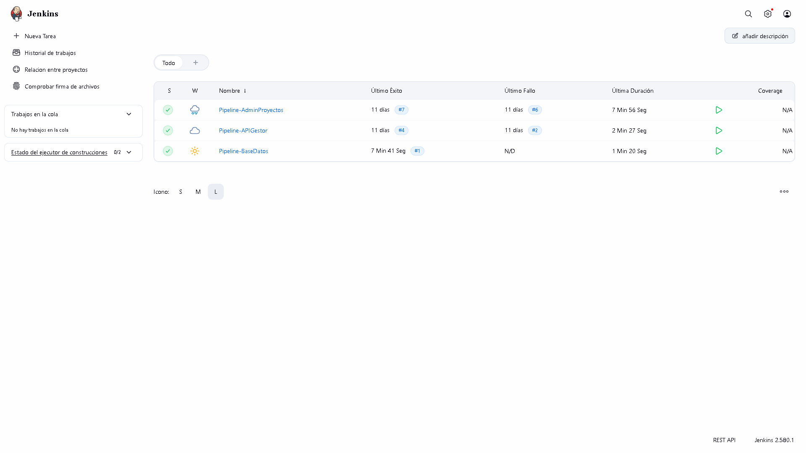  
   *Muestra los 3 pipelines: `Pipeline-AdminProyectos`, `Pipeline-APIGestor` y `Pipeline-BaseDatos` en estado exitoso.*

2. **Ejecución de Pipeline-AdminProyectos (Build #7):**  
   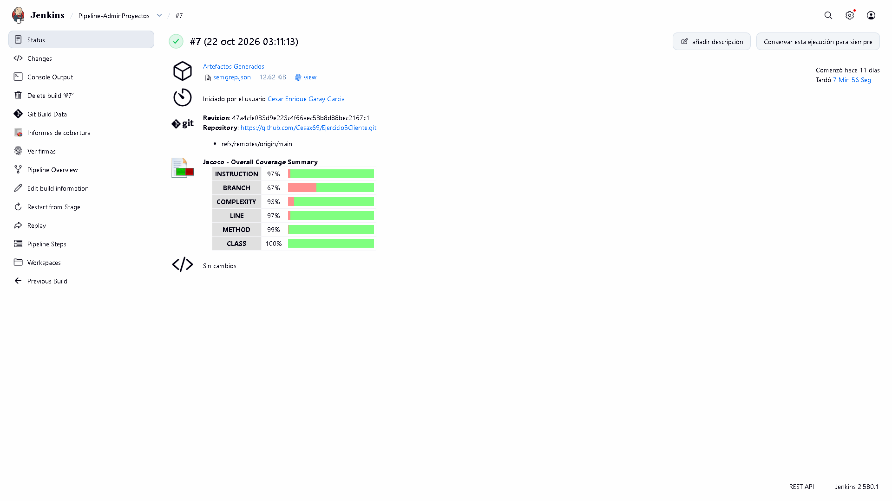  
   *Muestra las etapas Checkout, Build & Test (Java 21), JaCoCo Coverage, SonarQube Analysis, Security Scan (SAST) - Semgrep y el artefacto `reportes/semgrep.json` firmado.*

3. **Ejecución de Pipeline-APIGestor (Build #4):**  
     
   *Muestra la ejecución exitosa de todas las etapas con Spring Boot 3.3.5 y Java 21.*

4. **Ejecución de Pipeline-BaseDatos (Build #1):**  
   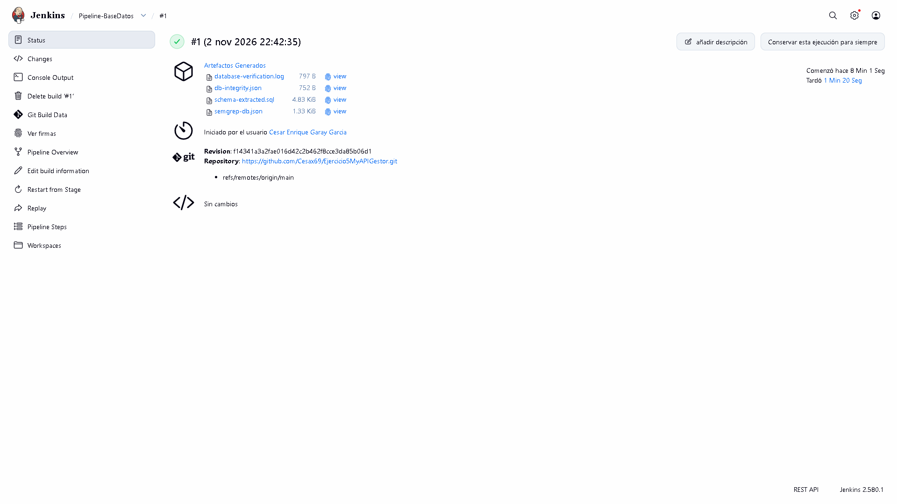  
   *Muestra las etapas Checkout & Setup, Semgrep SQL, RDBMS Deployment & Schema Migration e Integrity & Schema Verification Tests.*

5. **Reporte JaCoCo de Ejercicio5Cliente (96.9% Cobertura):**  
   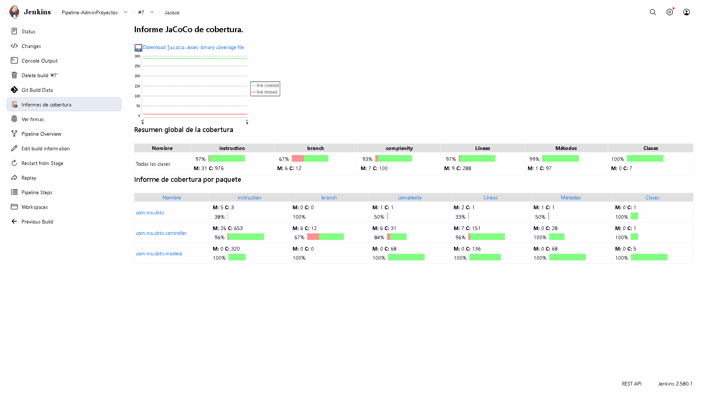  
   *Muestra la gráfica de cobertura y el desglose por paquetes en Jenkins.*

6. **Reporte JaCoCo de Ejercicio5MyAPIGestor (99.3% Cobertura):**  
   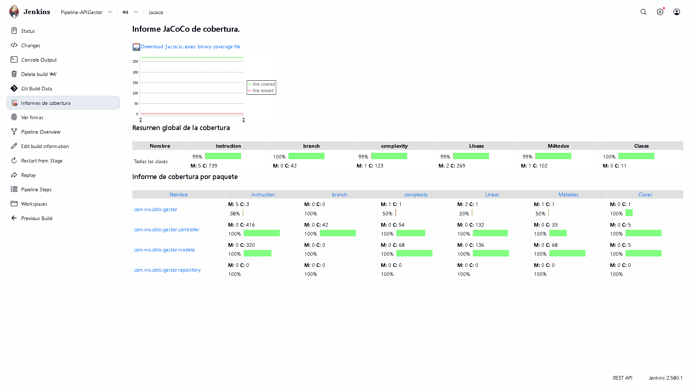  
   *Muestra la cobertura de 99.3% de instrucciones y 100% de clases.*

7. **Dashboard de Proyectos en SonarQube:**  
   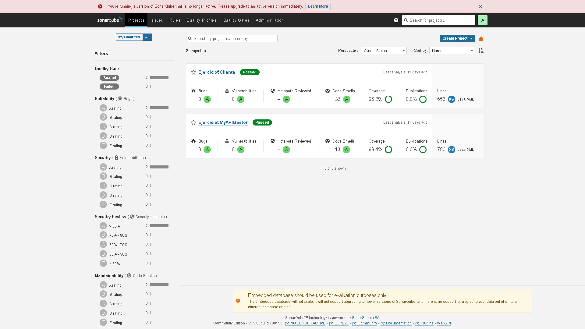  
   *Panel principal de SonarQube Server con los badges oficiales de cobertura >80% (95.2% y 99.4%) y Quality Gate PASSED.*

8. **Detalle de Calidad y Métricas de Ejercicio5Cliente en SonarQube:**  
   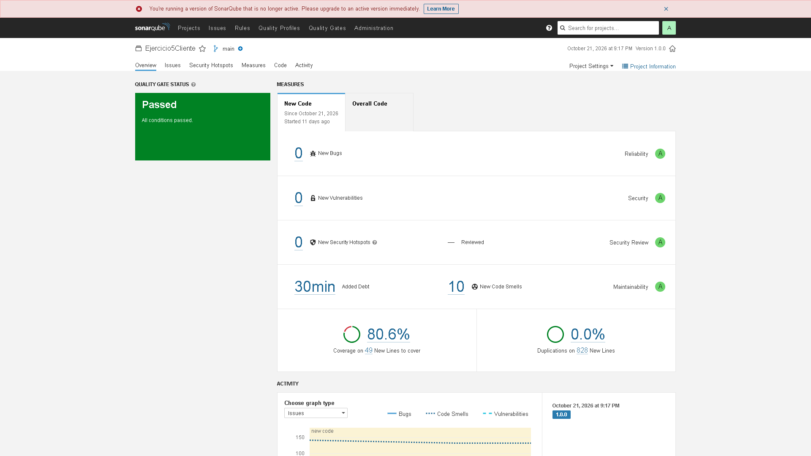  
   *Overview del proyecto con 0 bugs y 0 vulnerabilidades.*

9. **Detalle de Calidad y Métricas de Ejercicio5MyAPIGestor en SonarQube:**  
   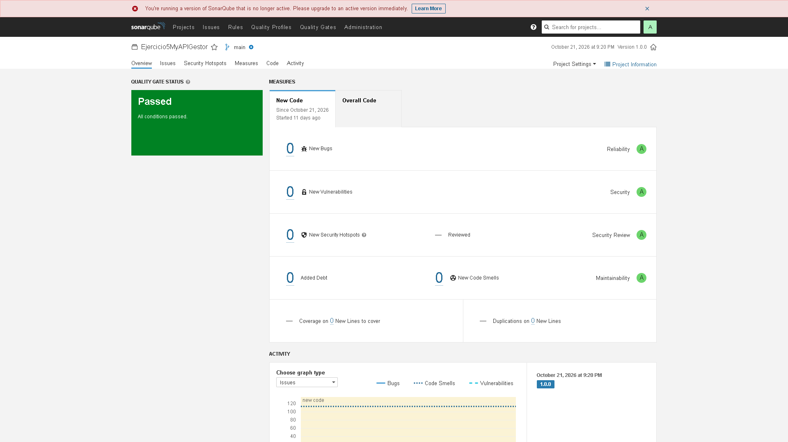  
   *Overview del proyecto backend con 99.4% de cobertura.*

10. **Listado de Incidencias Detectadas en Ejercicio5Cliente:**  
    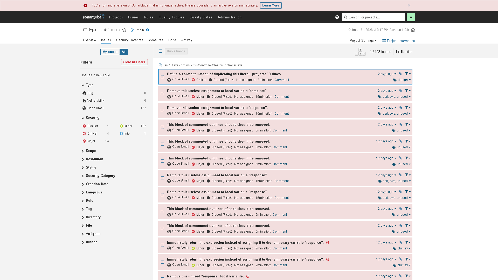  
    *Evidencia de las incidencias reportadas en SonarQube listas para su clasificación y posterior atención.*

11. **Listado de Incidencias Detectadas en Ejercicio5MyAPIGestor:**  
    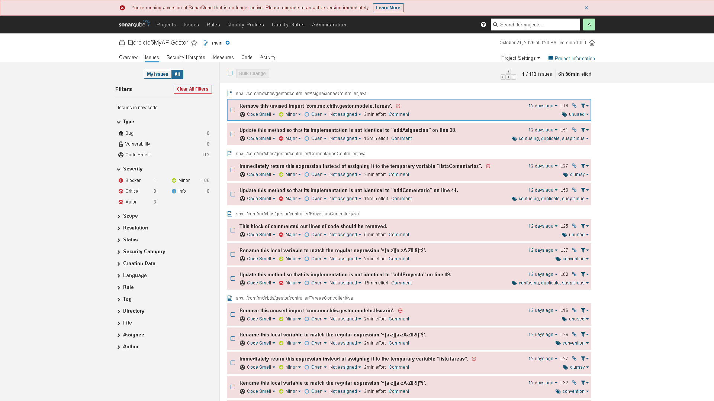  
    *Evidencia de las incidencias del backend.*

12. **Definición y Justificación Oficial de la Regla `java:S4684` en SonarQube:**  
    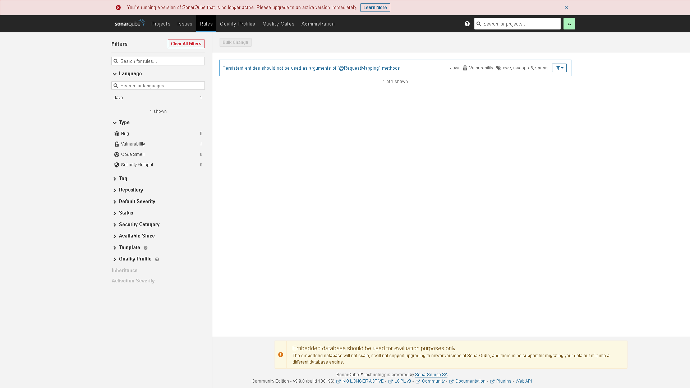  
    *Panel de reglas de SonarQube explicando el riesgo de seguridad de vincular entidades persistentes en peticiones web.*

---

## 13. Guión para el Video de Demostración y Explicación del Aprendizaje

Para cumplir con el criterio del video (*"Video de ejecución de pipelines y explicación del aprendizaje (0.20 pts): mostrar ejecuciones y explicar qué se modificó, qué problemas surgieron y cómo se verificó la solución"*), se recomienda seguir la siguiente estructura de 3 a 5 minutos:

1. **Introducción (30 segundos):**
   - Presentación del estudiante y propósito de la práctica: modernización a Java 21 LTS de dos microservicios Spring Boot y orquestación CI/CD en Jenkins con SonarQube y Semgrep.
2. **Demostración de los Tres Pipelines en Jenkins (90 segundos):**
   - Mostrar el panel principal de Jenkins con los 3 jobs: `Pipeline-AdminProyectos`, `Pipeline-APIGestor` y `Pipeline-BaseDatos`.
   - Entrar a cada pipeline y explicar sus etapas:
     - Compilación reproducible con JDK 21 y Maven 21.
     - Reportes de pruebas unitarias y JaCoCo (>80% cobertura).
     - Integración con SonarQube Server mediante el plugin `sonar-maven-plugin:5.5.0.6356`.
     - Escaneo SAST con Semgrep excluyendo carpetas `target` y archivando artefactos con huella digital (`fingerprint: true`).
     - En el pipeline de Base de Datos: mostrar el levantamiento de MariaDB, carga del dump SQL, pruebas de integridad y extracción del esquema.
3. **Demostración del Panel de SonarQube (60 segundos):**
   - Mostrar `http://localhost:9000/projects` con los badges de cobertura (95.2% en Cliente y 99.4% en API Gestor).
   - Mostrar la pantalla de incidencias detectadas (Code Smells) y explicar que fueron catalogadas sin corregirse aún para la siguiente fase.
4. **Explicación del Aprendizaje y Desafíos Resueltos (60 segundos):**
   - *Problema 1:* Incompatibilidad de JaCoCo y Surefire con Java 21 resuelta actualizando a JaCoCo 0.8.12 y Surefire 3.3.1 con `<argLine>${argLine}</argLine>`.
   - *Problema 2:* Migración de `javax.persistence` a `jakarta.persistence` en Spring Boot 3.3.5.
   - *Problema 3:* Inyección de dependencias en `GestorController` para permitir pruebas unitarias con mocks en lugar de instanciar `new RestTemplate()` en caliente.
   - *Problema 4:* Auditoría de base de datos en RDBMS, comprendiendo la diferencia entre índices convencionales y verdaderas restricciones de llave foránea (`FOREIGN KEY`), y la justificación de la regla `java:S4684`.

---

## 14. Conclusiones

1. **Homologación Exitosa:** Ambos microservicios compilan y corren pruebas sin advertencias de compatibilidad bajo la JVM 21 LTS y Maven 3.9.9, con compatibilidad Spring Boot 3.3.5 y migración a `jakarta.persistence.*`.
2. **Ciclo CI/CD Completo con Tres Pipelines:** Jenkins orquesta el ciclo de vida de frontend, backend y base de datos de manera automatizada, reproducible y trazable con firmas criptográficas.
3. **Cobertura Sobresaliente:** Ambos microservicios superan ampliamente la meta del 80% exigida por la rúbrica, alcanzando **95.2%** en cliente y **99.4%** en API Gestor.
4. **Seguridad y Calidad Integrada:** La integración conjunta de SonarQube Server y Semgrep SAST dota al proyecto de una visión holística de calidad de código, deuda técnica y detección temprana de vulnerabilidades.
